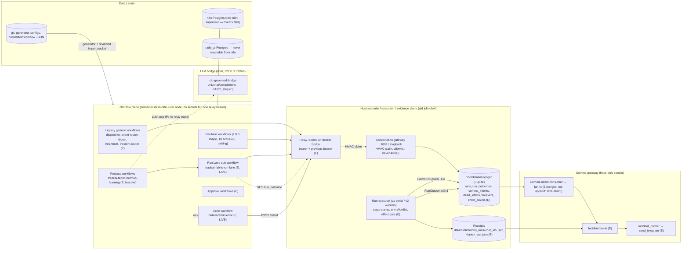
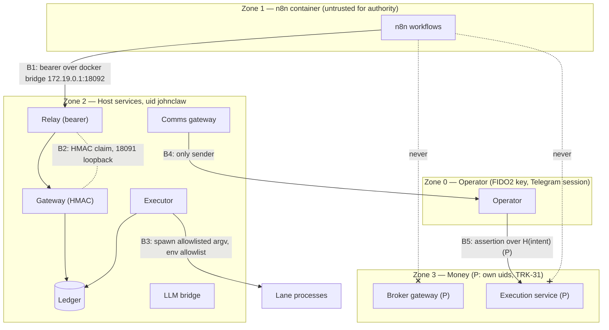

# n8n reference architecture — Trade AI automation fabric

```
Status:      PROPOSED reference architecture (informational; AGENTS.md is normative). For external architect review.
as_of:       2026-10-15
Measured at: origin/main 94601ff69; served release 5aa61048d (gap assessment 2026-10-15 02:35Z); n8n 2.43.0
Owner:       platform (n8n maturity program); Chief Architect: Agent A
Policy:      AGENTS.md §23.23 (10.0.0, ACTIVE: n8n owns flow, the host owns authority) and §23.24 (11.0.0, the
             mandatory workflow framework, operator-approved for ratification 2026-10-15)
Companion:   N8N_CONTRACTS_DESIGN.md (every contract named here: schema id, owner file, versioning, failure)
             scripts/check_n8n_workflow_framework.py (the §23.24 checker)
Sources:     ~/n8n-maturity-verification/arch-review-20261014/ARCHITECTURE_REVIEW_20261014/TARGET_ARCHITECTURE.md,
             REFACTOR_PLAN.md (+ addendum); docs/implementation/n8n-maturity/N8N_GAP_ASSESSMENT_AND_MATURITY_REVIEW_20261014.md;
             docs/architecture/n8n/ADR_COORDINATION_SECRETS.md
```

**Status markers.** **(E)** = exists in code on `origin/main` (and, where stated, served). **(P)** = proposed, not
built; each (P) names its tracker item: `TRK-n` = row n of
[`PROGRAM_TRACKER_20261015.md`](../../implementation/n8n-maturity/PROGRAM_TRACKER_20261015.md) §2; `GAP §n` = the gap
assessment section; `WSn-mm` = an architecture-review finding id (`FINDINGS.csv`); `RP-x` = a `REFACTOR_PLAN.md`
item; `FW-x` = a §23.24 framework element (the checker element id in
[`N8N_CONTRACTS_DESIGN.md`](N8N_CONTRACTS_DESIGN.md) §12).

---

## 1. Executive summary

Trade AI runs a single host (`ms01-openclaw`) with ~524 scheduled jobs, a trading Command Center, a governed LLM
bridge and a host-side communications gateway. In October 2026 the operator made n8n the **automation fabric**:
n8n owns *flow* (when, in what order, retry, approval timeline, escalation, when an LLM is asked), and the host keeps
*authority, execution and evidence* (allowlist, live/dry authority, idempotency keys, secrets, the audit ledger, the
only sender). This document is the reference architecture for that split.

The design in one paragraph: **n8n talks to the host through exactly one door** — a bearer-authenticated relay
(`scripts/n8n_run_relay.py`, `172.19.0.1:18092`) that re-signs each request as a short-lived HMAC claim to the
coordination gateway (`scripts/n8n_coordination_gateway.py` / `scripts/lib/n8n_coordination_gateway.py`, loopback
`:18091`). The gateway checks the request against the run allowlist and its never-list, records a run request in a
SQLite coordination ledger, and returns. A separate executor (`scripts/n8n_run_executor.py`) claims the request,
runs the lane's own allowlisted command under the lane's own lock, writes a receipt and a terminal **run outcome**,
and (for opted-in live lanes) claims a **semantic effect key** first. n8n's Run Lane sub-workflow polls the outcome
and owns retries; failures go to an error workflow that posts a **send-intent**, which the host queues for the
comms gateway — n8n never sends a message and never holds a messaging, broker, database or provider credential.

What is true today (2026-10-15): the primitives are LIVE (Run Lane, fabric error workflow, run outcomes, comms
intents, effect-claim library, `/v1/llm_step` on the bridge). **Zero business processes are owned by n8n**; the first
(hermes learning) is committed and inactive. 18 workflows are active; none is fully compliant with §23.24 (40%,
GAP §4). The largest structural gaps: no approval/HITL route, no n8n → bridge route for LLM steps, success
executions not saved on legacy workflows, drift check unscheduled, n8n DB role is superuser, the dead-man runs inside
n8n, and "exit 0 with no output" is not yet a failure state in any contract.

## 2. Scope

**In scope:** the `m8m-n8n` compose project (n8n + its Postgres), every workflow it stores, the relay, the
coordination gateway, the run executor, the coordination ledger, the governed LLM bridge as seen from n8n, the comms
intent path, and the configs that bind them (`config/n8n_*.json`, `config/lane_registry.json`,
`config/llm_process_registry.json`).

**Out of scope:** the broker execution subsystem (AGENTS.md §0 rule 2, §22 — n8n never reaches it), the NYC DOF
application (own instance, AGENTS.md §24.4), the Command Center UI, and the internals of individual lanes (each lane
is a black box with an allowlist row, a receipt and a health contract).

## 3. Glossary

| Term | Meaning | Where defined |
|---|---|---|
| **Lane** | one host command with an id, a lock, a timeout and dry/live args | `config/n8n_run_allowlist.json` (`N8nRunAllowlist@v1`) |
| **Registry row** | the schedule, stage and dispatch mode of a lane (schedule of record) | `config/lane_registry.json`; `scripts/lib/lane_dispatch.py` |
| **Stage** | `shadow` / `canary` / `cutover`; the executor's stage clamp forces `shadow` to `dry_run` | `scripts/lib/lane_stage_clamp.py` |
| **Relay** | the only HTTP surface n8n calls; bearer in, HMAC claim out | `scripts/n8n_run_relay.py` |
| **Gateway** | the HMAC-authenticated coordination API; records, never spawns | `scripts/lib/n8n_coordination_gateway.py` |
| **Executor** | drains REQUESTED runs, spawns the allowlisted command | `scripts/n8n_run_executor.py` |
| **Coordination ledger** | SQLite audit of record: `runs`, `dead_letters`, `breakers`, `run_outcomes`, `comms_intents`, `effect_claims`, `effect_owners` | `scripts/lib/n8n_coordination_ledger.py`, `scripts/lib/n8n_fabric_store.py`, `scripts/lib/effect_claim.py` |
| **Run key** | the run's idempotency key: `d:` (server-minted slot), `e:`/`g:` (event/generic), `p:` (process step) | `scripts/lib/n8n_due.py` `KEY_RE`; `scripts/n8n_workflow_templates.py` `PROCESS_KEY_PREFIX` |
| **Effect key** | `fx:<process>:<slot>:<input_version>`: one live effect per business slot, whoever fires it | `scripts/lib/effect_claim.py` |
| **Run Lane** | the one n8n sub-workflow that requests a run, polls its outcome, retries and times out | `tradeai-fabric-run-lane` |
| **Process workflow** | a business process (DAG of steps), each step a Run Lane call | `config/n8n_fabric_processes.json`; `tradeai-fabric-hermes-learning` |
| **Health contract** | per lane/workflow: purpose, owner, connects_to, healthy/degraded/failed, baseline, alerting | `config/n8n_health_contracts.json` (`N8nHealthContract@v1`) |
| **Send-intent** | a request to notify; the host decides delivery | `config/n8n_comms_intent_routes.json`; `CommsIntentReceipt@v1` |
| **Fan-in** | host collector of incidents from ledger, receipts and monitors into the notifier | `scripts/n8n_incident_fanin.py` (`N8nIncidentFanin@v1`) |
| **Generated workflow** | workflow JSON produced from git by the generator, never edited in the UI | `scripts/n8n_workflow_templates.py` |
| **Empty success** | a run that exits 0 and produces nothing the contract expects — **a failure** (§8.4) | `N8N_CONTRACTS_DESIGN.md` §5, §6 |

## 4. Planes and components



| Plane | Components | Owns | Never |
|---|---|---|---|
| **n8n flow plane** | n8n 2.43.0 container `m8m-n8n` + `m8m-n8n-db`; generated workflows; one credential `tradeai-run-relay` (`httpHeaderAuth`) | sequencing, triggers, retry/backoff (Run Lane), error routing, approval *timelines* (P), when an LLM is asked | holds a broker / messaging / provider / DB credential; sends; decides live vs dry; mints idempotency keys for a `d:` slot; is the only watcher of itself |
| **Host authority, execution, evidence** | relay, gateway, executor, coordination ledger, receipts, effect claims, lane registry, run allowlist | live/dry authority, the allowlist and never-list, idempotency, lane execution, the audit of record | runs a command not in the allowlist; trusts an n8n execution status as evidence |
| **Comms gateway** | `send_telegram` chokepoint, delivery ledger, `scripts/incident_notifier.py`, `scripts/n8n_incident_fanin.py`, `scripts/n8n_comms_intent_consumer.py` | delivery, suppression, caps, quiet hours, dedupe | depends on n8n for a P0/P1 page (§24.1) |
| **LLM bridge** | `scripts/lib/cio_governed_model_bridge.py` (`:8766` loopback), `scripts/lib/bridge_llm_step.py` | model selection, fallback (n8n: OAuth first, then DeepSeek — D10), caps, schema validation, audit | lets a workflow name a model, provider or key |
| **Data / state** | n8n Postgres (flow state, executions), coordination ledger (SQLite, `persistent-state/data/governance/`), `trade_ai` Postgres | flow state (n8n); evidence (ledger) | n8n reading or writing `trade_ai` (no DB credential in n8n) |

## 5. Trust boundaries



| Boundary | Control | Implemented by | Status |
|---|---|---|---|
| **B1** n8n → relay | bearer (`TRADEAI_N8N_RELAY_BEARER`, rotation slot `_PREVIOUS`); fixed route table; body ≤ 1024 B; exact-key bodies; text redaction | `scripts/n8n_run_relay.py` `ROUTES`, `MAX_BODY`, `INTENT_BODY_KEYS`, `_REDACT_RES` | (E) |
| **B1** network | relay on the docker bridge only; n8n UI 5678 loopback | ADR_COORDINATION_SECRETS.md; `N8N_CONFIGURATION.md` §1 | (E) binds; (P) firewall check for `172.19.0.1:18092` (GAP §4 s3, FW-S4) |
| **B2** relay → gateway | short-lived HMAC claim (`v, caller_id, project, iat, exp, nonce, scope`), caller `n8n-relay`, scopes `coordination_read` / `coordination_run` / `comms_intent`; the HMAC key never enters n8n | `scripts/lib/n8n_coordination_gateway.py` `CLAIM_FIELDS`, `SCOPES`, `RELAY_CALLER`, `sign_claim` | (E) |
| **B2** route policy | `ALLOWED_ROUTES` (6) and `FORBIDDEN_ROUTE_TOKENS` (broker, order, approve, grant, 2fa, totp, promote, rollback, telegram, send, sql, postgres, …) | same file | (E) |
| **B3** executor → lane | argv only from the allowlist; per-lane lock; `timeout -k`; stage clamp; per-lane env allowlist (`report` default, `enforce` opt-in) | `scripts/n8n_run_executor.py`, `scripts/lib/lane_stage_clamp.py` | (E); env `enforce` not global (P, `_env_policy`) |
| **B4** comms | n8n holds no bot token; intents are queued, deduped, capped, routed by a closed table | `config/n8n_comms_intent_routes.json`, `scripts/lib/n8n_fabric_store.py` | (E) |
| **B5** money | n8n can notify about an order intent, never confirm one; per-order operator assertion | AGENTS.md §23.23 "Broker"; TARGET_ARCHITECTURE §5 | (P) (trading lock LIVE, LOCKED: TRK-4; uid split TRK-31) |

## 6. Routes n8n may call, and what it may never touch (§23.23, §23.3)

The relay's route table is the complete list of host calls a workflow can make. It is printed by
`python3 scripts/n8n_run_relay.py --routes` (`N8nRunRelayRoutes@v1`) and checked against every workflow HTTP node by
`scripts/check_n8n_relay_contract.py`.

| Relay route | Gateway op (scope) | Writes | Returns | Caller workflows | Status |
|---|---|---|---|---|---|
| `GET /status` | `coordination/status` (read) | nothing | gateway status | probes | (E) |
| `GET /due?source=&lane=&limit=` | `coordination/due` (read) | nothing (one `relay_log.jsonl` line) | `DueResponse@v1` | dispatcher, event-router, digest, heartbeat, incident-router | (E) |
| `GET /runs/<lane_id>/last?mode=` | ledger projection (read) | nothing | `N8nRunRelayLast@v1` | per-lane gated chains, heartbeat | (E) |
| `POST /run` | `coordination/run` (run) | ledger `runs` row REQUESTED | `RunRequested@v1` / refusal | dispatcher, per-lane, Run Lane | (E) |
| `GET /run_outcome?run_id=` | `coordination/run_outcome` (read) | nothing | `RunOutcome@v1` | Run Lane | (E) |
| `POST /event` | `coordination/event` (read scope, `accept_event`) | ledger event row, lane `n8n-workflow-error` only | `N8nCoordinationReceipt@v1` | `tradeai-incident-router` (legacy) | (E) |
| `POST /intent` | `comms/intent` (comms_intent) | ledger `comms_intents` row QUEUED | `CommsIntentReceipt@v1` | `tradeai-fabric-error` | (E) |
| `GET /momentum-lifecycle` | momentum lifecycle projection (read) | nothing | candidate status | `tradeai-momentum-lifecycle-candidate` | (E) served by the handler **but missing from `ROUTES`**, so `--routes` and the relay contract check do not see it (scorecard FW-S2 finding) |
| `POST /llm_step` | bridge `/v1/llm_step` via relay | bridge audit row | `LlmStepResult@v1` | process workflows with an AI step | **(P)** — the bridge listens on loopback; no relay route exists (RP-B, TARGET_ARCHITECTURE §4; FW-G*) |
| `POST /approval/request` | approval service | approval request row | `approval_ref` | approval workflows | **(P)** — TARGET_ARCHITECTURE §5; GAP §5.3 (WS7-07) |
| webhook resume (event-driven start) | gateway-signed `Event@v1` push | n8n execution | — | event workflows | **(P)** — C4 must hold first (§23.23 "Controls") |

**Never, under any route or amendment window** (AGENTS.md §23.3, §23.14, §23.23; enforced by the gateway token
list, the allowlist never-list and the generator's forbidden node list):

- any broker route, order verb, position/account read, stop, arm, unlock, 2FA/TOTP, or broker credential;
- any send (Telegram, email, Slack, Discord nodes are forbidden node types; `FABRIC_FORBIDDEN_NODE_TYPES` in
  `scripts/n8n_workflow_templates.py`);
- SQL, Postgres, MySQL, Redis, file, SSH, `executeCommand` nodes (same list);
- guard grants, promote/rollback of a release, lane registry or allowlist edits;
- the `trade_ai` database, any secret file, the n8n API key;
- a model, provider or key name (LLM steps name a registered process and template only).

## 7. Run lifecycle

```mermaid
sequenceDiagram
  autonumber
  participant T as Trigger (schedule / process step / event P)
  participant W as Workflow (n8n)
  participant RL as Run Lane (n8n)
  participant R as Relay :18092
  participant G as Gateway :18091
  participant L as Ledger
  participant X as Executor
  participant Lane as Lane process
  participant E as tradeai-fabric-error
  participant F as Fan-in / notifier (host)
  T->>W: fire
  W->>RL: Execute Workflow {lane_id, mode, idempotency_key p:/d:, outcome_timeout_s}
  RL->>R: POST /run (bearer)
  R->>G: coordination/run (HMAC claim, scope run)
  G->>G: allowlist + never-list + key shape + mode
  G->>L: INSERT runs REQUESTED (run_id = idempotency_key)
  G-->>RL: RunRequested@v1 (or refusal = data)
  X->>L: claim oldest REQUESTED → RUNNING
  X->>X: stage clamp (shadow → dry_run); env allowlist
  X->>L: effect claim fx:<process>:<slot>:<ver> (live + opted-in lanes only)
  X->>Lane: safe_flock lock timeout argv (+ dry_run_arg / live_arg)
  Lane-->>X: exit code; LaneRunReceipt@v1 at output_signal
  X->>X: RunReceipt@v1/v2 (exit, lock skip, output_signal mtime before/after)
  X->>L: finish runs row; run_outcomes upsert (RunOutcome@v1); effect DONE/FAILED/UNKNOWN
  loop poll with backoff until terminal or budget spent
    RL->>R: GET /run_outcome?run_id
    R->>G: coordination/run_outcome (read)
    G-->>RL: RunOutcome@v1 status
  end
  alt success
    RL-->>W: FabricStepResult@v1 success
  else failed / refused_policy / lost
    RL-->>W: result (refusal is data); W fails → errorWorkflow
    W->>E: Error Trigger
    E->>R: POST /intent {domain fabric, kind workflow_error, ...}
    R->>G: comms/intent → comms_intents QUEUED (tier DIGEST, runbook_id)
    L->>F: consumer → incident fan-in → notifier → operator (P2 digest)
  end
```

Step-by-step, with the implementing file:

1. **Trigger.** Schedule trigger (all 16 legacy), Execute Workflow Trigger (Run Lane), Error Trigger
   (error workflows), Manual Trigger (probes, process manual run). Event webhooks are (P) (`tradeai-event-router`
   has a header-auth nudge webhook only). — committed JSON under `docs/implementation/n8n-maturity/workflows/`.
2. **Relay.** Bearer check, route match, exact-key body, size bound, forwards a signed claim. —
   `scripts/n8n_run_relay.py`.
3. **Run key.** `d:<lane>:<mode>:<YYYYMMDDTHHMM>` (server-minted by `/due`), `:a<n>` per retry attempt
   (`scripts/lib/n8n_due.py` `slot_key`, `KEY_RE`). Process steps use `p:<lane>:<mode>:<slot>`
   (`scripts/n8n_workflow_templates.py` `PROCESS_KEY_PREFIX`): accepted as a caller key today; **a live `p:` run is
   refused by the executor's effect gate (`effect_slot_unknown`) until the gateway validates `p:` keys against the
   process manifest (P, packet `docs/ops/packets/n8n-hermes-learning-flow-*`, TRK-21/33)**.
4. **Gateway.** HMAC, scope, allowlist (`config/n8n_run_allowlist.json`), never-list, mode; records REQUESTED;
   repeated `idempotency_key` returns the original (no second row). — `scripts/lib/n8n_coordination_gateway.py`.
5. **Executor.** Claims the row, applies the stage clamp, builds the child env, takes the lane's lock
   (`<lock>.dryrun` for dry runs), runs `safe_flock.sh <lock> timeout -k 30 <timeout_s> <argv>`. Class caps,
   reaper and DLQ/breaker on v2 (`config/n8n_executor.json`, `config/n8n_retry_policies.json`). —
   `scripts/n8n_run_executor.py`.
6. **Effect claim.** Only for a LIVE run of a lane listed in `config/n8n_effect_keys.json`; owner-epoch fence;
   refused claim = `RUN_REFUSED effect:<reason>`, nothing runs. — `scripts/lib/effect_claim.py`.
7. **Receipts.** `RunReceipt@v1` (serial) or `@v2` (workers) at `data/runtime/n8n_runs/<run_id>.json`; the lane's own
   `LaneRunReceipt@v1` at its `output_signal`. — executor; `scripts/lib/lane_last_receipt.py`.
8. **Run outcome.** `run_outcomes` row: `success | failed | refused_policy | skipped_lock` (`pending | unknown`
   while not terminal). — `scripts/lib/n8n_fabric_store.py`.
9. **Run Lane.** Polls `GET /run_outcome` (first 5 s, max 60 s), retries up to `max_attempts` (≤ 3) with backoff
   30→120 s, 3600 s execution timeout. — `scripts/n8n_workflow_templates.py` `RUN_LANE_*`.
10. **Error workflow.** Every fabric workflow sets `settings.errorWorkflow: tradeai-fabric-error`; it posts one
    send-intent with `runbook_id`. Legacy workflows use `tradeai-incident-router` → `POST /event` (6 of 16), 10
    per-lane workflows have none (FW-A1 fails; GAP §4).
11. **Incident fan-in.** The consumer turns QUEUED intents into fan-in incidents (P2 digest) — merged, not yet
    served/applied (TRK-16, TRK-25). The fan-in also reads ledger RUN_* states, receipts and monitor rows directly.
12. **Operator.** `scripts/incident_notifier.py` delivers (P1 at once, P2 batched/held 22:00–07:00 ET, P3 never
    sends). The P1 path never depends on n8n (§24.1).

## 8. Failure and recovery

### 8.1 Failure classes

| Class | Example | Where it is decided | Route | Status |
|---|---|---|---|---|
| Transport | relay/gateway unreachable, HTTP 5xx | relay (`relay_gateway_unreachable`), Run Lane `retryOnFail ×2` | Run Lane retry → error workflow | (E) |
| Policy refusal | `RUN_REFUSED`, already `RUNNING`, `relay_lane_not_allowlisted`, `relay_live_not_enabled` | gateway / relay | **data** (outcome `refused_policy`), not an n8n error | (E) in Run Lane; **legacy dispatcher still records them as errors** (599/day, WS1b-07) → (P) FW-A4 |
| Lane failure | non-zero exit, timeout, executor lost | executor | outcome `failed`; DLQ + breaker on v2 | (E) |
| Lock skip | another scheduler holds the lock | executor (exit 75) | outcome `skipped_lock` | (E) |
| **Empty success** | exit 0, nothing produced (every item `skipped: no_runner`) | **nowhere today** — only `supervisor_breach_detector.py` `NO_OUTPUT` after 3× cadence on the output-signal mtime | must be outcome `failed` / `empty_output` with the contract's `expected_output` rule | **(P)** FW-M6; contracts design §5–§6 |
| Lost outcome | no terminal outcome within the Run Lane budget | Run Lane | intent `run_lane_outcome_lost` (`runbook_id n8n-run-lost`) | (E) route; (P) RUN_LOST state in the receipt |
| Effect conflict | second claim of a held `fx:` key | executor effect gate | `RUN_REFUSED effect:effect_already_claimed` | (E), inert (lane list empty for live) |
| Workflow drift | live graph ≠ git | `scripts/check_n8n_workflow_drift.py` | P1 | (E) checker; (P) schedule + P1 (TRK-40) |
| n8n down | container, DB or runner failure | host watchers | host dead-man → notifier | (P) host dead-man outside n8n (GAP §9 item 6; WS1-15) |

### 8.2 Recovery mechanisms

| Mechanism | Implementation | Status |
|---|---|---|
| Retry (one owner) | Run Lane retry budget + backoff; legacy: `retryOnFail` on generic HTTP nodes + `config/n8n_retry_policies.json` via `scripts/lib/n8n_due.py` | (E); legacy callers not on Run Lane (P) |
| Dead letter | ledger `dead_letters`; `scripts/n8n_dlq.py` (list, release) | (E) |
| Circuit breaker | ledger `breakers` (`breaker_threshold: 3`) | (E); half-open (P, WS1-05) |
| Fallback | commented cron line; `docs/ops/ROLLBACK_COMMANDS.md` | (E) |
| Fenced single-owner switch | `effect_claim.py set-owner` (compare-and-swap on epoch) | (E) code; first use with hermes learning (P, TRK-33) |
| Manual recovery | `runbook_id` → `docs/runbooks/INCIDENT_RESPONSE.md` or a lane runbook | (E) on `tradeai-fabric-error` intents only; (P) per workflow metadata |
| Restore | nightly `scripts/n8n_lab_backup.sh`, weekly `scripts/n8n_lab_restore_drill.sh` | (E) |

### 8.3 Independence

The P0/P1 page path, the dead-man and the kill switch do not depend on n8n (§24.1; §23.23 "Independence"). Today
`heartbeat-watch` runs inside n8n and reports through the fan-in, so the watcher is inside what it watches (WS1-15):
**(P)** a host-timer dead-man and an off-box dead-man (GAP §9 item 6).

### 8.4 "Exit 0 is not evidence" — empty success is a failure

AGENTS.md §0 rule 8 says exit code 0 is not evidence of work. Measured case: `hermes_research_worker_pool.py` ran
hourly from July with exit 0 while every lane reported `skipped: no_runner`; only the breach detector's `NO_OUTPUT`
noticed. The architecture therefore treats **"ran, exit 0, produced nothing the contract expects"** as a failure
state, decided on the host from the lane's receipt against a declared `expected_output` rule in its health contract
(the rule, receipt fields and outcome are specified in `N8N_CONTRACTS_DESIGN.md` §5–§6). Until that is built, the
§23.24 checker scores the monitoring element FW-M6 **fail** for any workflow whose contract lacks an
`expected_output` rule.

## 9. Security model

| Control (WS9) | Statement | Implemented by | Status |
|---|---|---|---|
| C1 workflows from git | generated by `scripts/n8n_workflow_templates.py`; imported by reviewed packet under a `cron` grant naming ids; never edited in UI; drift → P1 | generator; `scripts/check_n8n_workflow_drift.py`; `scripts/check_n8n_activation_grants.py` | (E) generator, checker; (P) scheduled drift + P1 (TRK-40) |
| C2 approval = request | n8n approval is a request; authority is a host record; money needs operator assertion | AGENTS.md §23.23 "Broker" | (P) approval route; policy (E) |
| C3 closed-schema LLM | process id + template id; closed output schema; enum branching; host re-check | `scripts/lib/bridge_llm_step.py`, `config/schemas/n8n_llm_step_outputs.json` | (E) at bridge; (P) n8n reach |
| C4 HMAC on inbound events | gateway HMAC claim; bridge network or loopback only | `scripts/lib/n8n_coordination_gateway.py` | (E) for relay → gateway; (P) for event webhooks |
| C5 credential custody | one credential (`tradeai-run-relay`); no broker/messaging/provider/DB credential; `N8N_BLOCK_ENV_ACCESS_IN_NODE=true` | ADR_COORDINATION_SECRETS.md; `INDEX.json` `policy.credential` | (E) |
| C6 independence | P0/P1 and PANIC never depend on n8n; approvals fail closed | §24.1 | (E) P1 path; (P) dead-man |
| C10 supply chain | community packages off; image pinned `n8nio/n8n:2.43.0`; node-type allowlist | generator `*_ALLOWED_NODE_TYPES` / `*_FORBIDDEN_NODE_TYPES` | (E); (P) pin by digest |
| DB role | n8n DB role not superuser | — | **fails** (WS1b-12; FW-S5) |
| Secrets in logs | relay redacts bearer/DSN/`sk-`/long tokens from intent text | `scripts/n8n_run_relay.py` `_REDACT_RES` | (E) |

## 10. Observability

| Signal | Join key | Store | Status |
|---|---|---|---|
| n8n execution | `execution_id` (+ custom data `run_id`, `lane_id`, `process_id`, slot) | n8n DB; successes saved only on fabric workflows (`saveDataSuccessExecution: all`) | (E) fabric; (P) legacy + custom data (FW-M1, FW-L1) |
| Run request / receipt | `run_id` = idempotency key; `requested_by: n8n:workflow:<id>` | ledger `runs`; `RunReceipt@v1/@v2` files | (E) |
| Run outcome | `run_id` | ledger `run_outcomes` | (E) |
| Lane output | `lane_id`, `ok_at` | `LaneRunReceipt@v1` at `output_signal` | (E) |
| Relay log | route, lane, refusal | `relay_log.jsonl` | (E) |
| LLM step | `run_id` ↔ `execution_id`, process, template, decision | `LlmStepAudit@v1` | (E) |
| Intents | `intent_id`, `dedupe_key`, `runbook_id` | ledger `comms_intents` | (E) |
| Health contracts | lane / workflow id | `config/n8n_health_contracts.json` | (E) 126 contracts (65 REVIEWED, 61 DRAFT) |
| Breaches | lane | `Breach@v1` (`scripts/supervisor_breach_detector.py`) | (E) |
| Framework score | workflow id | `scripts/check_n8n_workflow_framework.py` (`N8nWorkflowFrameworkReport@v1`) | (E) this PR (offline); (P) live mode on a host schedule |
| Metrics stack | — | none (`/metrics` 404) | (P) WS8-10 |

## 11. Decisions and rationale

| # | Decision | Rationale | Alternatives rejected |
|---|---|---|---|
| D1 | n8n owns flow, the host owns authority (§23.23) | the ledger, allowlist, stage clamp, idempotent keys and receipts were measured as the sound part (WS1); retries, DAGs and approvals in host shell were the unsound part (WS1b-03/08/09) | n8n as pure scheduler (keeps flow in shell); n8n as authority (puts secrets and live/dry in a UI-editable tool) |
| D2 | one door: relay → HMAC gateway | one place to authenticate, rate-bound and log; the HMAC key never enters n8n (ADR_COORDINATION_SECRETS) | direct n8n → gateway (key in n8n); n8n → DB |
| D3 | refusals are data | 599 of 611 n8n errors in 24 h were policy refusals (WS1b-07): errors that are not errors drown real failures | treating refusals as errors |
| D4 | Run Lane is the only retry owner | two retry owners double-fire; a single sub-workflow is testable | per-node retries everywhere |
| D5 | semantic effect key across schedulers | a flock prevents overlap, not cron-then-n8n duplicates (RP addendum 1) | lock only |
| D6 | workflows generated from git, drift = P1 | a UI edit is a control-plane change (WS9 C1) | UI authoring + export |
| D7 | send-intents, never sends | one sender keeps caps/quiet hours/dedupe in one reviewed table (§24.1) | Telegram node in n8n |
| D8 | LLM steps name a process + template, closed schema, host re-check | prompt injection and model drift are contained at the bridge (WS9 C3) | AI Agent node with a provider credential |
| D9 | empty success is a failure | exit 0 is not evidence (§0 rule 8); a pool ran for months producing nothing | mtime-only freshness |
| D10 | n8n LLM processes route OAuth first, DeepSeek on failure or for higher reasoning. Operator decision 2026-10-15, verbatim: "in terms of n8n, then, we should try OAuth first. And if OAuth fails or if the answer needs higher reasoning, then we go to DeepSeek." | OAuth lanes are $0 (subscription); DeepSeek is metered and is the working fallback and the reasoning lane. Routing policy rows `route_profile: n8n_oauth_first` (the three `N8nCoordination` processes and `hermes_tag_engine`, the one process an n8n fabric step calls): grok OAuth → chatgpt OAuth → DeepSeek FAST; an OAuth lane not enabled on the host is skipped; an OAuth transport error, timeout, 401/403/429, outage or empty / invalid / schema-invalid answer moves to the next lane; `reasoning_tier: high` (registry or template) puts the row's `reasoning_lane` (DeepSeek `PRO_THINK`) first, OAuth after it; a schema-valid OAuth answer below `escalate_below_confidence` (or carrying an `escalate_on_values` flag) is re-asked ONCE on DeepSeek inside the caps, else returned flagged `escalation_skipped_cap`. Contract: N8N_CONTRACTS_DESIGN §10 | DeepSeek first (pays for answers OAuth gives free); OAuth only (no fallback for an OAuth outage or a hard question) |

## 12. Open questions and risks

| # | Question / risk | Impact | Owner | Tracker |
|---|---|---|---|---|
| Q1 | How does n8n reach `/v1/llm_step`? A relay route (`POST /llm_step`, scope `llm_step`) vs a scoped bridge token in n8n | blocks the AI/LLM class | Agent A + operator (credential = §17) | (P) RP-B; FW-G* |
| Q2 | Approval service design (operational vs money classes), single-use resume token | blocks HITL | operator | (P) TARGET_ARCHITECTURE §5 |
| Q3 | Live authority is in three places (registry, relay live list, allowlist `live_arg`): 11 "live" canary rows run dry | wrong belief about what runs | Agent A | GAP §2; WS1-07 (P reconciler) |
| Q4 | n8n DB role superuser | an n8n compromise is a DB compromise | operator | WS1b-12 |
| Q5 | Dead-man inside n8n | silent total failure | operator + agent | GAP §9 item 6 |
| Q6 | Single host, no UPS, never cold-booted | total outage | operator | TRK-30 |
| Q7 | `p:` keys not validated by the gateway | live process steps impossible (fail-closed today) | Agent A | TRK-21/33 |
| Q8 | `expected_output` rule absent from all 126 contracts | empty successes stay green | contract owners | FW-M6 (this PR measures it) |
| R1 | Legacy per-lane workflows lack errorWorkflow/timeout | failures unrouted | Agent A | scorecard remediation order |
| R2 | The relay serves `GET /momentum-lifecycle` outside its `ROUTES` table | an unreviewed route surface | Agent A | scorecard wave 3 |

Measured compliance (this PR): **0 of 18 active workflows fully compliant, 46.9% by element**; the reference
mature workflow scores 100% — `docs/implementation/n8n-maturity/N8N_FRAMEWORK_SCORECARD_20261015.md`.

## 13. Evidence index

Relay `scripts/n8n_run_relay.py`; gateway `scripts/n8n_coordination_gateway.py`, `scripts/lib/n8n_coordination_gateway.py`;
executor `scripts/n8n_run_executor.py`; due `scripts/lib/n8n_due.py`; fabric store `scripts/lib/n8n_fabric_store.py`;
effect `scripts/lib/effect_claim.py`; generator `scripts/n8n_workflow_templates.py`; relay contract check
`scripts/check_n8n_relay_contract.py`; drift `scripts/check_n8n_workflow_drift.py`; grants
`scripts/check_n8n_activation_grants.py`; health contracts `scripts/build_n8n_health_contracts.py`,
`scripts/check_n8n_health_contracts.py`, `scripts/lib/n8n_health_contracts.py`; LLM step `scripts/lib/bridge_llm_step.py`;
fan-in `scripts/n8n_incident_fanin.py`; consumer `scripts/n8n_comms_intent_consumer.py`; breach detector
`scripts/supervisor_breach_detector.py`; framework checker `scripts/check_n8n_workflow_framework.py`; committed
workflows `docs/implementation/n8n-maturity/workflows/` (generic, `fabric/`) and
`docs/implementation/n8n-parallel/workflows/generated/` (per-lane); reference mature workflow
`docs/implementation/n8n-parallel/workflows/reference/`.
