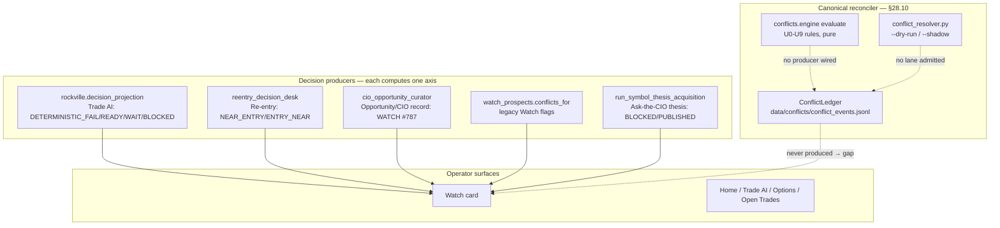

# CIO Review / decision-authority chain — root-cause investigation (Phase 0)

```
Status:      ACTIVE (investigation report, read-only)
as_of:       2026-10-28 13:20 ET
Measured at: origin/main f4ce1e4a2 (worktree wt/resync-20261028)
Authority:   AGENTS.md 26.0.0 §28.9 / §28.10 / §28.12; docs/governance/OPEN_ITEMS.md
Supersedes:  none
See also:    docs/designs/DSN-20261023-ask-the-cio.md · scripts/lib/conflicts/ · scripts/lib/cio_truth.py
```

## 1 · Executive summary

The Watch screen is not one bug. It is the **mid-transition state of the §28.10 conflict engine**:

- The canonical reconciliation layer (`scripts/lib/conflicts/`) is **fully built but has no scheduled producer**, so `data/conflicts/conflict_events.jsonl` is never written. Every card therefore falls back to the literal string `conflict ledger not yet produced`, and the **legacy flag list** (`watch_prospects.conflicts_for`) is what the operator actually sees. This transition is already tracked as **OI-118**.
- Six decision authorities compute state on **different axes** and the UI renders them side by side with **no stated precedence**, because the one engine that would rank them is not live.
- "Ask the CIO" is **not a review** — it is a **debt-ordered thesis-acquisition run** (`run_symbol_thesis_acquisition.py`) gated on evidence sufficiency. A request whose symbol has unconfirmed identity is blocked as `REQUEST_IDENTITY_UNCONFIRMED` before anything runs.
- The automatic refresh triggers that *would* keep reviews fresh (`cio-ask-lifecycle` hourly, `cio-ask-material-events` */5) are **registered but `NEVER_SCHEDULED`** (shadow / dry-run only).

One-sentence version: **every mechanism needed for a transparent, auditable, continuously-refreshed CIO decision platform already exists in code; the missing piece is wiring — a scheduled conflict-ledger producer, and the admitted lifecycle/refresh lanes.**

## 2 · Current decision-authority graph (verified from source)



**Verified facts:**

| Authority | Module | State it produces | Authoritative for |
|---|---|---|---|
| Trade AI (Rockville) | `scripts/lib/rockville/decision_projection.py` | `DETERMINISTIC_FAIL`, `READY`, `WAIT`, `BLOCKED`, `MANAGING`, … | deterministic trade mechanics; LLM cannot override |
| Re-entry desk | `reentry_decision_desk` → `data/runtime/reentry_decision_desk_latest.json` | `NEAR_ENTRY` / `ENTRY_NEAR` | re-entry proximity |
| Opportunity / CIO record | `scripts/cio_opportunity_curator.py` + `config/opportunity_conviction.yaml` | conviction 0–100, `WATCH` / `ADD` / … | CIO stance & conviction |
| Legacy Watch flags | `scripts/lib/data_broker/watch_prospects.py:181` | ad-hoc flags | (legacy; shown "until the conflict engine ships") |
| Ask-the-CIO thesis | `scripts/run_symbol_thesis_acquisition.py` | `BLOCKED` / `READY_FOR_SYNTHESIS` / `PUBLISHED` | research freshness, not a stance |

The §28.10 rulebook (`config/conflict_rulebook.json`) and engine (`scripts/lib/conflicts/engine.py`) are the **only** intended reconciler. Precedence is `U0 safety > U1 data-error > U2 canonical-missing > U3 canonical-stale > U6 gate > U5 agreement > U4 superseded > U7 conflict > U8 flapping`. None of it renders because the ledger is never produced.

## 3 · Root causes (ranked)

### RC-1 — No conflict-ledger producer is scheduled (primary)

- `scripts/lib/conflicts/__init__.py` exports **read-only evaluation only** — "Read-only conflict evaluation; persistence and execution are separate."
- The only writer is `ConflictLedger.reconcile(..., apply=True)` (`scripts/lib/conflicts/ledger.py:129`), which appends `data/conflicts/conflict_events.jsonl`.
- The host runner `scripts/conflict_resolver.py` calls it, but only in `--shadow` mode; its own docstring states: *"There is no live/notification mode. Scheduler admission and operator activation are owned separately by W8."*
- `config/lane_registry.json` has **no `conflict-resolver` lane** (`rg '"conflict'` → empty). W8 admission never happened.
- Consequence: `conflict_events.jsonl` is absent → `scripts/lib/conflicts/api.py:109,130,156` returns `gap: {"reason": "conflict ledger not yet produced"}` → rendered by `apps/command-center-v3/src/components/conflicts/ConflictLine.tsx:10` as "Conflict check unavailable".

### RC-2 — Six authorities, one unreconciled surface

§28.10 says one engine decides what is a conflict and the owner decides real ones; §28.11 permits the legacy producers to keep running until the engine ships (sunset 2026-12-31). Until RC-1 is fixed, the card shows `DETERMINISTIC_FAIL`, `NEAR_ENTRY`, `WATCH`, and the legacy flag list **simultaneously**, each labeled, none authoritative.

### RC-3 — "Ask the CIO" is a manual, evidence-gated acquisition, not a review

`scripts/run_symbol_thesis_acquisition.py` flow: `build_debt_ordered_queue` → (`open_requests_ranked` prepends open asks) → `request_blocker` → `build_evidence_catalog` → `build_synthesis_packet` gate → Flash → publish. A blocked result records `BLOCKED` with `remaining_gaps`; `symbol_thesis_priority.attempt_reason` renders it as "Blocked: waiting for evidence — <gaps>". No consumer re-runs the row when new evidence arrives.

### RC-4 — Identity gate blocks the ask before research starts

`scripts/lib/watch_review_publication.py:28-40` `request_blocker` returns `REQUEST_IDENTITY_UNCONFIRMED` when `identity_status != "CONFIRMED"` or `security_guid` is missing. The ANET card ("REQUEST_IDENTITY_UNCONFIRMED · 9 runs since you asked") is this gate firing repeatedly: the ask row lacks a confirmed security identity, so every acquisition run short-circuits and writes a BLOCKED ledger row. The exact producer of the 9 runs in 3 days is an open trace (see §5).

### RC-5 — Automatic refresh lanes are registered but not running

| Lane | Schedule | Registry state |
|---|---|---|
| `run-governed-symbol-thesis-acquisition` | `17 17 * * 1-5` | `ACTIVE`, KEEP_ON_CRON, cadence 72h |
| `watch-review-workers` (Maria) / `-cio` | `16:05` / `16:20` Mon/Wed/Fri | `ACTIVE` |
| `cio-ask-lifecycle` | `0 * * * *` (hourly) | **`NEVER_SCHEDULED`**, n8n dispatcher, `stage: shadow` |
| `cio-ask-material-events` | `*/5` | **`NEVER_SCHEDULED`**, `stage: shadow` |
| `cio-ask-research` | (n8n) | `SHADOW`, dispatch `dry_run` |
| `conflict-resolver` | — | **no lane** |

The hourly Ask lifecycle (`config/cio_ask.json` `lifecycle.interval_seconds: 3600`, `max_attempts_per_evidence: 2`) that would re-attempt and expire reviews is **inactive** ("no workflow installation, activation or natural-slot evidence. Admission remains inactive.").

## 4 · Answers to the ten questions (condensed)

1. **CIO review lifecycle** — a review *is* an acquisition ledger row (`data/cio/symbol_thesis_acquisition_ledger.jsonl`) + an Ask row in `symbol_thesis_priority` + a `research.review_lifecycle` block written to the prospect record by `watch_review_publication.link_publication`. Created on operator ask (or debt queue); updated only by a new acquisition run; expires via `_pending_expiry_hours`; refresh = a later run; invalidated = nothing (backoff only).
2. **Automatic triggers** — live: the 17:17 weekday acquisition run and the Mon/Wed/Fri watch-review workers. Inactive: hourly lifecycle, */5 material events, re-answer (mode `shadow`). No "new evidence arrived → re-run blocked review" trigger exists.
3. **Freshness / staleness** — reviews stay visible because (a) the acquisition runs ~1/day and blocks on evidence, (b) backoff only skips 3-in-24h identical blocks, (c) the refresh lanes are `NEVER_SCHEDULED`, (d) `packet_expired`/`as_of` exist in projections but are not surfaced on the card.
4. **Authority** — six producers, one reconciler that is not wired (RC-2). Final state per §28.10 would be the conflict engine's ranked verdict; today the UI shows parallel truths.
5. **CIO memory** — synthesis is built from a **cataloged evidence packet** (`build_synthesis_packet` from RAG supporting/contradictory/structured), i.e. memory-backed for research, but stance/conviction are computed by the curator from `config/opportunity_conviction.yaml`, and the prospect store is "interim — not live" (OI-064). Whether the acquisition actually reads portfolio/trade history is a W5 open trace.
6. **LLM oversight** — Flash is synthesis/challenge only (`symbol_thesis_synthesis.py`), governed by the bridge; deterministic gates (`gate`, `request_blocker`, `review classification`) wrap it; no separate freshness/contradiction evaluator model is wired.
7. **Evidence engine** — thresholds `MIN_SUPPORTING=2`, `MIN_COUNTER=1`, `MIN_TOTAL_APPROVED=3` (`symbol_thesis_evidence.py:29-31`); blocked reasons are `BLOCKED_PENDING_ACQUISITION_AND_CURATION` / `BLOCKED_NO_EVIDENCE`; gaps surfaced as `insufficient_supporting_rag` etc.
8. **Conflict engine** — exists (engine + profiles + rulebook + ledger + resolver), not enabled (no producer, RC-1).
9. **Explainability** — `DETERMINISTIC_FAIL` exposes blockers via `_first_blockers`; but the Watch card shows no unified "reviewed at / trigger / next review / authoritative source" block; each authority stamps its own provenance.
10. **UI correction** — the contract is §4 of this report's companion design (Phase 1); the fields are derivable from already-present `as_of`/`source`/`expiry`/`next_review` fields.

## 5 · Open traces to close in Phase 0 (not yet verified)

- **"9 runs since you asked" in 3 days** vs the 17:17 weekday schedule — identify the additional trigger (manual re-ask? a second scheduler? the Ask lifecycle fired before its row was flipped `NEVER_SCHEDULED`?). Read `data/cio/symbol_thesis_acquisition_ledger.jsonl` on the host.
- **`REQUEST_IDENTITY_UNCONFIRMED`** string is produced by `request_blocker` but not found verbatim in `scripts/` — confirm it is the ask row's recorded `identity_status`, and why ANET's ask row never resolved identity (identity spine / `identity_carriage`).
- **W5 memory**: confirm which stores `build_evidence_catalog` actually reads for a live symbol (portfolio/trade history vs RAG only).

## 6 · Code / table / API / scheduler inventory (verified)

**Modules**
- `scripts/lib/conflicts/engine.py` · `ledger.py` · `cio.py` · `api.py` · `__init__.py`
- `scripts/conflict_resolver.py` (host runner; `--dry-run` / `--shadow`)
- `scripts/lib/cio_truth.py` (`stance_for`, `conflicts_for:398`, `conflict_payload:434`)
- `scripts/lib/data_broker/watch_prospects.py` (`conflicts_for:181`, card assembly `:554`)
- `scripts/lib/rockville/decision_projection.py`
- `scripts/cio_opportunity_curator.py`, `scripts/lib/data_broker/opportunity.py`, `config/opportunity_conviction.yaml`
- `scripts/run_symbol_thesis_acquisition.py`, `scripts/lib/watch_review_publication.py`, `scripts/lib/symbol_thesis_priority.py`, `scripts/lib/symbol_thesis_evidence.py`, `scripts/lib/symbol_thesis_synthesis.py`
- `config/cio_ask.json`, `config/conflict_rulebook.json`

**Stores / ledgers**
- `data/conflicts/conflict_events.jsonl` (conflict ledger — **never produced**)
- `data/conflicts/conflict_observations.jsonl`, `data/conflicts/reports/`
- `data/cio/symbol_thesis_acquisition_ledger.jsonl` (acquisition outcomes)
- `data/runtime/reentry_decision_desk_latest.json` (re-entry desk)
- `data/cio/cio_opportunity_projection.json` (opportunity/CIO record)

**Lanes** (see §3 RC-5 table)

## 7 · Fix recommendations (for Phase 1 design / Phase 2 build)

1. **Admit `conflict-resolver` (W8)** — the single highest-leverage fix. Schedule it (n8n dispatcher, `--shadow` first, then its ledger write) so `conflict_events.jsonl` is produced and §28.10 goes live. This alone removes "conflict ledger not yet produced" and activates the real reconciler.
2. **Admit `cio-ask-lifecycle` + `cio-ask-material-events`** (hourly / */5) so blocked asks re-attempt when evidence clears, and expire per `max_attempts_per_evidence`.
3. **Add a "new evidence → re-run blocked acquisition" trigger** (currently missing).
4. **Surface the unified freshness/authority block** (Phase 1 Q10 contract) on every CIO-driven card — display only.
5. **Retire the legacy `watch_prospects.conflicts_for` flag path** once the engine ships (OI-118 sunset).

All of it stays `MBI_BEHAVIOR = 0` — this is reconciliation and display of advisory states; nothing sizes, orders, or stops.

## 8 · OPEN_ITEMS overlap (already known — not re-discovered)

OI-118 (the exact transition), OI-010 (Ask size-gate dead heading), OI-019 (shadow flag gates nothing), OI-032 (shared research never observed end-to-end), OI-033 (tagger off), OI-064 (prospect/commitments no producer). These will be cited, not duplicated.
