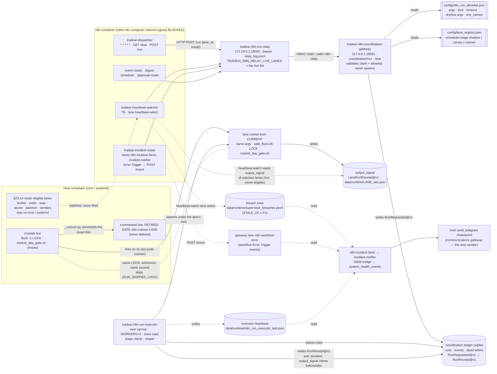

# N8N runtime architecture — cron vs n8n dispatch, relay, gateway, executor, locks, ledger, watch and incidents

```
Status:      ACTIVE
as_of:       2026-10-14T13:30:00-04:00
Measured at: CURRENT 8ae8a5b91-main-exact-phase2-20261013-234427 (per ~/n8n-maturity-verification/status-20261014-1130/MIGRATION_STATUS.md);
             source read at origin/governance/agents-advisory-market-data-lanes-20261014 73eebc5c1
Owner:       platform (n8n maturity program)
Policy:      AGENTS.md §23 (where this file differs, AGENTS.md wins). Cutover standard: §23.21 (8.0.0, PROPOSED;
             operator ruling 2026-10-14 ~11:05 ET)
```

This is a picture of how a scheduled Trade AI lane runs today, from either scheduler, and where its evidence lands.
It adds no rule. Configuration detail (ports, units, env names, limits) lives in
[`N8N_CONFIGURATION.md`](N8N_CONFIGURATION.md); the procedures live in
[`N8N_ONBOARDING_STANDARD.md`](N8N_ONBOARDING_STANDARD.md) and
[`RUNBOOK_CUTOVER_ROLLBACK.md`](RUNBOOK_CUTOVER_ROLLBACK.md).

## 1. The diagram



## 2. How to read it

- **Two schedulers, one lock.** Until a lane is cut over, its cron line and the dispatcher can both start it. The
  allowlist `lock` equals the cron line's `flock` lock, so the second starter exits `RUN_SKIPPED_LOCK` and the
  business effect happens once (AGENTS.md §23.12; `lane_dispatch.r1_canary_lock_matches`). The registry gate
  (`check_lane_registry --state-drift`) prevents the double *schedule*: a dispatcher row at `shadow` or `canary`
  declares the overlap; at `cutover` a live cron line is `CRON_PRESENT_WHILE_SCHEDULER_N8N` (§23.2).
- **The stage decides the mode.** `shadow` rows are fired `dry_run` only; `canary` rows may be fired `live` once the
  lane is in the relay's `TRADEAI_N8N_RELAY_LIVE_LANES`; the executor's stage clamp (`scripts/lib/lane_stage_clamp.py`)
  downgrades anything the stage does not allow. At `cutover` the cron line is commented and only the dispatcher fires.
- **The gateway never spawns.** It validates the claim against the registry and allowlist and writes a
  `RunRequested@v1` row. The executor (own cgroup, `WORKERS=3`) runs the lane from CURRENT with the cron line's argv,
  lock and gates, and writes the `RunReceipt@v1` (AGENTS.md §23.3).
- **Evidence is the ledger row plus the output signal, never an n8n execution status** — n8n soft-deletes successful
  executions (`EXECUTIONS_DATA_SAVE_ON_SUCCESS=none`), so filter `"deletedAt" IS NULL` and prove success from the
  ledger and the lane's `LaneRunReceipt@v1` (AGENTS.md §23.19; `N8N_CONFIGURATION.md` §1).
- **Watching is not scheduling.** `heartbeat-watch` (cut over: n8n is its only scheduler, 775 live `RUN_DONE` at
  2026-10-14 11:06 ET) reads the `output_signal` of watched lanes — including the §23.14 lanes that stay on cron or
  systemd — and hands a stale one (`STALE_2X`) to the incident fan-in (AGENTS.md §23.14 first bullet).
- **Incidents fan in; only the host sends.** `scripts/n8n_incident_fanin.py` (cut over; READ_ONLY_ADVISORY) reads
  receipts that already exist — the breach rows `heartbeat-watch` writes (`STALE_2X` is P1), the gateway's
  `n8n-workflow-error` events, the executor heartbeat, the `--alert` timer receipts and the watchdogs — and opens
  one coordination event per finding; the notifier and the SIEM bridge carry it on. Nothing in n8n sends Telegram or email; the host `send_telegram` chokepoint is the
  only sender (§23.3, §24.1). The P1 notifier and SIEM bridge stay on host cron so the P1 path does not depend on n8n.

## 3. Evidence paths

| What | Where |
|---|---|
| Coordination ledger | `~/trade-ai-releases/persistent-state/data/governance/n8n_coordination_ledger.sqlite` (open `mode=ro`) |
| Relay log | relay `relay_log.jsonl` (27,615 entries at 2026-10-14 11:06 ET per `status-20261014-1130/MIGRATION_STATUS.md`) |
| Lane output signal | `$TRADEAI_STATE_ROOT/data/runtime/<lane>_last.json` (`LaneRunReceipt@v1`) |
| Cutover receipts | `$TRADEAI_STATE_ROOT/data/runtime/n8n_cutover/<lane_id>-<ts>.json`, `n8n_cutover_last.json` (`CutoverReceipt@v1`) |
| Crontab backups | `~/.local/state/tradeai/backups/` (`_cutover.py` `BACKUP_DIR`) |
| Migration matrix (2026-10-14) | `~/n8n-maturity-verification/status-20261014-1130/` and `status-20261014-p1/` |
