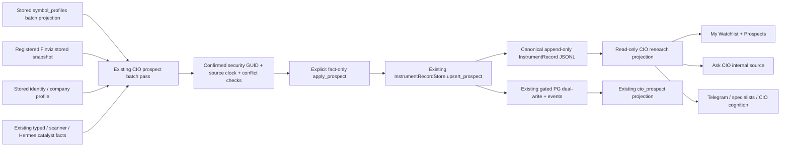

# C1: shared CIO company facts on My Watchlist and Prospects

Design-Task: DSN-20261024-watch-company-facts-P1-T1
Worker: codex-c1-company-facts-20261024
Base: ca39056af0b67491310a7267d75e2a0c882bc7d0
Status: SOURCE_IMPLEMENTED / FIXTURE_VERIFIED. Publication and runtime application pending.

Operator requirement, via the coordinator: “Everything in C1-C3 must go through CIO memory, not a Watch-only store.”

The two Watch screens display the saved `InstrumentRecord.research.company_facts` for the row's `security_guid`.
They show company name, a description limited to two lines, sector, industry, and the current catalyst with its
publication/observation date, source and publication link when one is stored. Missing fields state the gap; missing,
undated, future or older-than-30-day catalysts display **No catalyst on file**, with stale retained evidence labelled.
Descriptions retain their full value and provenance on hover. No company fact falls back to an upstream page value.

## Source and field contract

The existing extensible `research` JSON carries `CIOCompanyFacts@v1`. No central schema, database migration,
new store, new writer class, scheduler, process registration, provider request or Watch HTTP write is introduced.
The sibling `research.review_lifecycle` is preserved and has a public typed read shape shared with C3.

| Field | Stored producer input | Original clock / limitation |
| --- | --- | --- |
| Company | Saved `TickerKnowledgeProfile@v1` or Finviz `company` | Profile row update / Finviz cached time; source identity binding is declared |
| Description | `data_broker.symbol_profile` over `symbol_profiles.description_1s` | `updated_at` is a **row update**, not proof of when an upstream company fact changed |
| Sector / industry | Stored profile metadata and registered Finviz snapshot | Original source-row/cache clock, source name and raw timestamp retained |
| Catalyst | Existing builder's typed, scanner and Hermes catalyst facts | Original `published_at` or `observed_at`, source/feed and URL when present |
| Review lifecycle | Saved CIO record's sibling `research.review_lifecycle` | Requested, researching, answered and resolved clocks remain distinct |

All collection occurs once per batch. The profile reader performs one parameterized bulk SELECT; Finviz and saved
identity profiles are file snapshots. No provider is called when either screen, Ask CIO or cognition reads these facts.
Symbol-keyed metadata is labelled `confirmed_registry_symbol_at_batch` / `symbol_keyed`, not misrepresented as an
upstream GUID assertion. Explicit mismatched source GUIDs are refused and recorded as conflicts. Dated retained
values outrank undated new values; original clocks are preserved. Divergent source values remain on the facts block.
Hermes search results additionally pass the existing `hermes_scalp_catalyst_record.verify_identity`:
the original headline/first-source evidence must name the whole-word ticker or stored company name;
generic index pages, unrelated headlines and missing/conflicting company names cannot become the current
company catalyst. Raw research remains on the historical catalyst block with its source evidence.
Unknown source timestamps remain unknown. A new assembly/cache time never substitutes for a publication time.

Catalyst relevance and arbitrary source confidence (including values above 1) are not probabilities. The selected
publication carries the source's factual-verification declaration and separately states independent verification
`NOT_MEASURED`. Undated, future, wrong-GUID and expired catalyst facts cannot become a current publication.

## Writer and consumer boundaries

`cio_prospect_builder.build` stays pure. It merges the facts into the existing research keys in its proposal.
The existing CLI remains safe by default:

- No mode flag / `--dry-run`: no durable writes (except explicitly named report files).
- `--write-shadow`: shadow artifact, comparison and receipt only; the canonical record bytes remain unchanged.
- **Separate explicit `--write-company-facts`**: merge only this facts extension into an existing valid prospect record,
  validate with `apply_prospect`, then use `upsert_prospect`. Do not promote shadow stance, conviction, stage or clocks.
- A missing record, multiple current records for one GUID, legacy non-prospect or failed validation is a named gap;
  no record is minted, selected arbitrarily or silently promoted.
- The existing registry approval, operator dual-write flag and table-presence gates still control PG. Flag-off does
  not contact PG. The batch reports `INERT` or `FAILED` and returns non-success for a requested incomplete write.
  A PG failure preserves the canonical append and reports only its exception class, without connection details.
- `DUAL_WRITE_ACKNOWLEDGED` describes the writer acknowledgements, not an operational consumer-readback proof.
  A no-change batch reports `NOT_MEASURED_NO_CHANGE` for consumer synchronization. Divergent stores require owner
  reconciliation; this change does not retry or choose between them automatically.

The read-only `data_broker.cio_company_facts` loads the canonical record tips, rejects ambiguous/mismatched GUIDs and
publishes the named facts and review summary. `watch_prospects.gather` reads it once per shared cache (60s), so My
Watchlist and Prospects receive the same record. Their existing UI fetch cadence is 120s. Catalyst aging is calculated
from original dates; there is no provider refresh on a page read.

Ask CIO has an actual `internal.cio_record_research` source. Dated company facts retain their source clock and citation;
an undated value is explicitly an availability observation, not a newly dated source fact. Research review answers and
resolution clocks are exposed separately. Existing paid-research process registration and spend policy remain intact.

The shared cognition pack adds `COMPANY_FACTS` and `REVIEW_LIFECYCLE` sections for all selected securities.
The standalone ticker cognition and `telegram_fields` path carry the same saved facts, so Telegram's real
`assemble_context` path and specialist envelopes consume them. Unrelated private research keys and account quantities
are excluded from the public summary. Existing account, stance, source clocks and financial truth remain unchanged.

## Verification and limits

Native tests use isolated temporary stores and pinned clocks with `psycopg2` explicitly hidden. They cover batch reads,
identity refusal, retained clocks, catalyst dates/verification, exact judgment and sibling-research preservation,
legacy/ambiguous/missing records, default/shadow no-write, gated fake PG, visible PG failure/inertness, the canonical
PG projection, actual Ask CIO/Telegram/specialist context and My Watchlist/Prospects record equality.

Playwright uses the actual built SPA with a static server that rejects APIs and has no proxy. Browser fixtures fulfill
all API reads and refuse external traffic, writes and websockets. Both screens pass at 1440px and 412px, with full
company text retained, two-line descriptions, missing-data states and no page/panel horizontal overflow. Mobile
captures scroll the company facts into view. Synthetic company evidence is labelled test-only.

Local test receipt: [packet](packets/c1-company-facts-20261024/RECEIPT.json).
Reproduce the Python suite with the commands listed in that receipt. Build with `npm run build` under
`apps/command-center-v3`; run the fixture test `e2e/watch-company-facts.spec.ts` against the no-proxy static server.

No live data, provider, database, server, scheduler, grant, credential, broker, order or stop action was performed.
Source validation does not establish runtime company coverage: records absent/legacy/ambiguous or lacking inputs will
say so until the existing CIO owner resolves them and runs an authorized batch. Publication, authorized application,
PG synchronization and natural consumer observations belong to the coordinator/operator follow-up.
