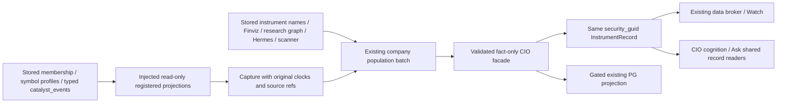

# C1: stored catalysts and short registered company names

**Status:** Source implementation and private-COPY proof; coordinator publication and operator application pending.
**Task:** DSN-20261024-c1-catalyst-P1-T1.
**Base:** accepted main `9228634873392073f5849aaa77ec9b9121eb6094` (#2074).

The fact-only population job omitted the registered `catalyst_events` bulk read: its capture contained only
membership/profiles, while its file loader read Hermes and scanner data. Source records could therefore contain
no catalyst even when the database held typed dated events. The company field accepted arbitrary prose and
retained the old paragraph as a candidate, allowing SMCI's newer business description to outrank its registered name.

The existing `cio-company-facts-populate` path now captures registered typed catalysts once per batch, feeds them
through the existing prospect catalyst assembler and writes only `research.company_facts` through the existing
`apply_prospect → upsert_prospect` facade. Its existing `--with-db` lane invocation automatically uses this read.
No lane, workflow, schedule, contract, policy, credential or live flag was changed. No additional writer/store,
provider lookup, request-time enrichment, broker read or investment judgment was introduced.



## Source and trust rules

`catalyst_record_readonly` retains the original `published_at`, `created_at`, source URL and row reference. Its
compatibility `at` field remains available to old consumers, but ingestion time is never relabelled as publication.
An event with no publication time carries an observation/row-created clock explicitly. The existing 30-day
publication/observation window remains; old, undated, future and wrong-GUID candidates do not become current.
Hermes still requires its existing company-identity verification. Missing/failed capture is distinct from a
successful query with no eligible rows. No catalyst on file stays missing with its reason.

Confidence weights do not become probabilities or independent verification. The legacy confidence-threshold
boolean remains available to its historical decision path; it is explicitly **not** a source verification flag
on the saved company fact. Source basis/status and `independent_verification=NOT_MEASURED` remain visible.
The captured table has publication/creation clocks, no scheduled-event date column. This fix selects an eligible
latest stored material fact; it does not invent an upcoming event date from either clock.

Company names come from stored `schwab_instrument_evidence.description`, as required by AGENTS' company-name
source rule. Values over 180 characters, prose clauses or multiple sentences are rejected; legal abbreviations
and initials remain valid. Both new and retained candidates are checked. Original source clocks and genuine
source disagreements remain; rejected paragraph evidence is retained without presenting it as a company name.
Missing name files do not use the evidence loader's synthetic empty-document timestamp. No hardcoded name map,
identity creation, substring-guessed legal name or issuer/stance promotion was added.

## Actual COPY proof

The inspected collector ran once through normal formal tool review. PostgreSQL read-only mode and 15s statement /
2s lock timeouts were verified before whitelisted SELECTs. Output/copies are private mode0600 files outside source
and production state. The nine copied evidence files were stable while read; per-query observation times remain
separate and are not claimed to be a transaction-wide consistent snapshot.

Capture: `2026-10-24T22:21:32.459604+00:00`, SHA-256
`2c74849bbc5082e773092c1ea903e575055d7aa0a80365d5345cf841cb287b95`.
The scoped 30-day target query captured 1,216 typed rows, normalized by the existing projection to 252 distinct
records across 102 symbols. This is a different scope/time from the operator's earlier 910-row observation.

| Watch population (104 names) | Before | After private-COPY pass |
|---|---:|---:|
| Current catalyst under the existing dated window | 0 | 54 |
| No eligible current catalyst | 104 | 50 |
| Short company name | 101 | 103 |
| Description | 101 | 101 |
| Sector / industry | 103 / 103 | 103 / 103 |
| All four company fields | 99 | 101 |

SMCI now reads **SUPER MICRO COMPUTER** from the stored instrument record, observed
`2026-08-27T19:24:56+00:00`; the older original clock is preserved. It no longer displays the business paragraph.
The immutable source copy and dry-run bytes stayed unchanged. Private-copy apply updated 198 existing records,
created zero, and retained all 256 canonical records. Judgment/identity/other fields and sibling research remained
identical, apart from the facade's expected revision/update clock. A repeated pass performed **zero writes** and
reported 203 unchanged records. Production writes, providers and live HTTP requests: zero.

The initial proof harness incorrectly counted `prospect_revision` as a judgment change. The retained failed log
and field comparison establish that only the expected research/revision/update fields differed; the corrected
proof strictly compares every other field, including provenance. Raw evidence remains in
`/home/johnclaw/.cache/rtc/codex-c1-catalyst-20261024/`. No failed receipt was rewritten as green.

Every remaining catalyst and company-field gap is in
[the summary](packets/c1-company-catalyst-20261024/COPY_PROOF_SUMMARY.json) and
[the 50-name evidence table](packets/c1-company-catalyst-20261024/REMAINING_CATALYST_GAPS.md).
Missing current news is a data condition, not permission to manufacture a catalyst. Wrong GUIDs/unverified search
hits stay held. No backfill of those gaps was attempted.

## Verification and operator continuation

Affected whole-file native suites, read-only COPY/idempotency checks, source lint, frontend build and required
ratchets are recorded in the adjacent validation receipt. The new gate also proves missing capture versus proven
empty, original publication versus row-created time, stale/future/undated/wrong-GUID rejection, legacy-confidence
non-verification, retained-paragraph correction, valid legal names, and the actual existing-lane capture hook.
One new gate serialization failure was corrected using canonical registry formatting and its whole suite rerun.
Known unrelated full-profile protected-state fixture refusals were not repeated or exempted; this is scoped proof,
not a claim that the complete project suite or production readiness is green.

After the coordinator publishes, merges and releases the accepted source, the operator verifies exact CURRENT
source hashes in this packet, then runs the existing entrypoint in preview first:

```bash
cd /home/johnclaw/trade-ai-releases/CURRENT
.venv/bin/python scripts/cio_company_facts_populate.py --dry-run --with-db --state-root /home/johnclaw/trade-ai-releases/persistent-state
```

The operator's subsequent exact apply command is:

```bash
cd /home/johnclaw/trade-ai-releases/CURRENT
.venv/bin/python scripts/cio_company_facts_populate.py --apply --with-db --state-root /home/johnclaw/trade-ai-releases/persistent-state
```

Apply requires valid `state-write` authority for the existing canonical record/latest receipts and `db-write` when
the already-authorized PG dual-write flag is enabled. This worker requested or exercised neither. Existing PG
migration/readiness/divergence checks remain intact; no flag is enabled automatically. No cron/service authority
is needed for these source-only changes, and no admission or scheduler state is asserted here. The prior C1
admission packet is historical; this packet pins the new source without rewriting its receipts or review metadata.
Native completion dependency on Hermes and actual runtime/alert delivery are not proved by a nominal schedule offset.
