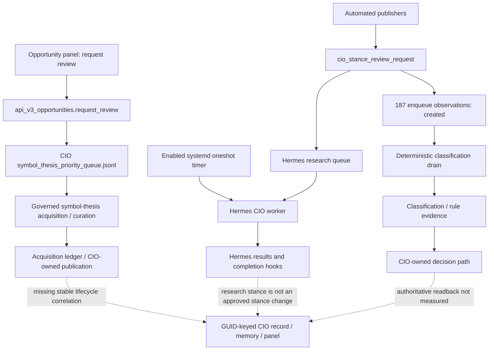

# C3: CIO review-request lineage and lifecycle audit

Design-Task: DSN-20261024-cio-review-lifecycle-P1-T1
Source baseline: e5fa288ecc6971d1a55a79f7e3ba5bbbb46c5dd0
Observation window: 2026-10-24 14:58–15:15 UTC.
Status: READ_ONLY_AUDIT_COMPLETE; implementation and publication pending.

The opportunity-panel review button and the 187-row stance-review ledger are **different request paths**.
The button writes the CIO symbol-thesis priority queue. The stance-review ledger records automated
publisher requests and their enqueue outcomes. Its unchanged `created` labels do not establish that
Hermes failed to process those requests. Neither path currently supplies a complete, GUID-keyed
request-to-research-to-authoritative-stance lifecycle to the panel and shared CIO answer context.

## Measured request and output populations

| Population | Observation | Limit |
| --- | --- | --- |
| Opportunity priority queue | 153 rows; one `operator_opportunity_view` request | No stable request ID; 7-day TTL can remove a symbol from the open list without a terminal event |
| Later acquisition publications | 94/153 have a later publication by symbol and time; 0/1 for the operator request | Temporal association is not causal request attribution |
| Acquisition ledger | 1,226 rows: 811 BLOCKED, 220 SYNTHESIS_FAILED, 100 PUBLISHED, 95 LLM_BUDGET_EXHAUSTED | These are attempts across all symbols, not 1,226 operator requests |
| Automated stance-review ledger | 187 rows, all `created`: 23 screener, 158 proposal, 6 social publishers | These rows are enqueue observations, not an updated work queue |
| Exact research-ID matches | 187/187 in Hermes projection: 179 completed, 8 failed | A completed research job is not proof of an authoritative CIO stance change |
| Research results | 179 exact result matches with `thesis_stance`; none with decision IDs | Suggested research stance must not be promoted into CIO authority |
| Classification terminal receipts | 187: 55 applied, 83 already classified, 49 no deterministic match | Terminal classification includes an explicit non-match; it is not 187 successful changes |
| Identity | 182 have `subject_guid`: 178 CONFIRMED, 4 unresolved; 5 lack identity status | Normalize confirmed GUID aliases; never mint or infer identities for the remainder |
| Authoritative stance changes / memory outcomes | NOT_MEASURED | No privileged database query, credential read or inference from research text was made |

The stance ledger SHA-256 is `b759be71c60417e8f5cd615500ccbe0008288a94c62047c2907813cd290f3c29`
(89,307 bytes, captured 15:00 UTC). Aggregate evidence is in the adjacent packet. Runtime files can
change after capture; these counts describe the recorded observation window.

## Drainers, schedules and monitoring

At the earlier successful service/timer readback on October 24, `tradeai-hermes-cio-worker.service` was a successful
`Type=oneshot`: inactive/dead, exit status 0, last started 11:00:06 EDT and exited 11:00:09 EDT.
Its timer was enabled, active/waiting, last fired 11:00:06 EDT and next due 11:15:27 EDT.
An inactive successful oneshot between timer fires is expected; it does not establish a failed worker.
A subsequent refresh was refused by the sandbox (`Operation not permitted` connecting to the user bus);
collection stopped without an alternate transport. The successful observation is retained as historical,
not represented as a current service census.

The registry records the Hermes worker as an ACTIVE systemd lane, the classification drain as an
ACTIVE host cron at `20 7,19 * * 1-5`, and governed thesis acquisition as ACTIVE host cron at
`17 17 * * 1-5`. The standalone symbol-news curation monitor is RETIRED because its script was
folded into health-tick. These rows have no n8n dispatcher admission. A fresh live n8n census was
not performed, so this is registry/source evidence rather than a claim that every runtime workflow
was inspected.

The coordinator's authorized cron capture confirms the two cron commands at lines 998 and 880.
Its SHA-256 was verified as
`b2097df25a62e6824b6e7046d55a3f279b9b058e76b1bcd09c2da89b5a748626`.
It was captured approximately 04:35 UTC, not freshly recaptured by this audit. No crontab read,
replacement, edit or removal was executed. The drain's runtime receipt reports `ok`, mode `live`,
started 2026-10-23T23:20:01Z and finished 23:20:02Z.

The operative n8n contract catalogue has no contract for these four lane IDs or the review queues.
Existing `hermes_runtime_status` and `hermes_queue_health` are consumed by the control-plane API;
they distinguish a successful idle oneshot from failure and expose queue state. This is useful
runtime monitoring, but does not prove a review-specific created-age SLA, exact research correlation,
panel lifecycle, authoritative stance readback, or alert delivery for an unanswered operator request.

## Proposed source change and acceptance

Keep the existing request queues and CIO writer. Add stable request/research correlation and store
the lifecycle as `InstrumentRecord.research.review_lifecycle`, keyed by confirmed `security_guid`.
Use the existing validated prospect writer and its gated PG projection, preserving other research
keys and all CIO judgments. Do not introduce a Watch-only record or a second stance authority.

Record `created`, `researching` and `answered` only from their corresponding producer/consumer
events. Record `conflict_resolved` only after the CIO-owned record and linked outcome actually
confirm settlement; research text and classification completion alone are insufficient. Preserve
failure and blocked outcomes, original event clocks, research ID, old/new authoritative stance and
the reason. Expose the same facts to the panel, CIO memory and Ask-the-CIO source context.

Propose a review-age health contract and monitor with a named threshold, owner, alert route and
bounded recovery. A proposed threshold is not a reviewed operative contract. No scheduler,
contract admission, paid-process registration, live send or worker activation is part of this audit.
Acceptance requires pinned-clock fixture proof that an actual request is researched and answered,
the GUID-keyed CIO record and an Ask-the-CIO answer share its outcome, unresolved requests remain
visible beyond the old TTL, and the health check detects an overdue `created` request.

Publication prerequisites remain the psycopg2-hidden tests, host-path and coverage ratchets,
docs index, frontend build and actual mocked-page screenshots at 1440/412 for any UI change.
The coordinator owns merge and release. This audit does not mark the runtime or the work package done.
