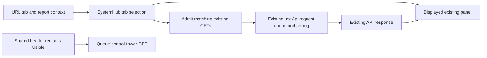

# SITE: System tab requests and URL state

Design-Task: DSN-20261024-site-system-tabs-P1-T1

Worker `codex-site-system-tabs-20261024`; claim `20261024T213512Z-codex-38fc1515`.
Accepted base `e148e2a65303d8aa6e6c9437784ae83f9e2bebe8` (PR #2072).

## Behavior and scope

System previously started 18 top-level reads on every mount and kept polling all of them, regardless of the visible tab. Seventeen have only tab-specific consumers. They now use the shared API hook's existing admission option; hiding a tab stops those intervals and cancels its queued requests. The queue-control-tower read remains global because its existing values are displayed in the common header. Existing child panels already mount only on their visible tab.

The URL now owns tab selection. Tab names are recognized without case sensitivity, clicking a tab creates browser history, and Back/Forward restores the visible tab. Report `query`, `focus` and unrelated parameters survive a tab change. Report query/focus changes are read on navigation rather than captured only at mount. A YouTube-cookie focus still opens its existing Pipeline panel; no credentials are supplied or read by this package.

All existing panels, field expressions, controls and handlers remain. Shared `useApi`, endpoint semantics, source clocks, scheduler state, broker code and execution flags are unchanged. This is a partial fix for SITE P1 finding 12 plus System navigation. It does not establish the overall endpoint-size or server-RSS budget, or correct existing System health definitions.

## Request and displayed-field map

The change does not introduce business facts or a new writer. These are the existing API fields consumed by the page. Store/writer reconciliation belongs to the parent SITE truth-resolver packages; no source ownership is inferred from an endpoint name.

| Visible consumer | Existing GET | Existing display fields |
|---|---|---|
| Common header and Queue | `/api/v2/system/queue-control-tower` | `timers_total`, `cron_count`, `services_running`, `llm_jobs`, `sections` |
| Pipeline | `/api/v2/system/pipeline-health` | `ingestion`, `curation`, `llm`, `rag`, `jobs`, `as_of` |
| SIEM | `/api/v2/system/siem` | `severity`, `recent_events`, `correlated`, retention fields |
| Crons | `/api/v2/system/cron-compression` | `total_crons`, `unique_scripts`, `duplicates` |
| LLM | `/api/v2/local-llm-status`, `/api/v2/llm-health` | Existing status keys, `lanes`, `review_corpus`, `hybrid_policy` |
| Apps | `/api/v2/system/applications` | `applications`, `summary`, `versions_checked_at` |
| Jobs | `/api/v2/system/scheduled-jobs` | `timers`, `cron` |
| Access | `/api/v2/system/access-links` | `services`, `tailscale`, `drive`, `hermes_reports` |
| Admin | `/api/v2/atm/config`, `/api/v2/admin/accounts` | Existing `config`, account rows and display flags |
| Admin | `/api/v2/admin/audit-log`, `/api/v2/admin/strategy-enablement`, `/api/v2/admin/cron-retryable` | Existing `entries`, `rows`, `jobs` |
| Admin | `/api/v2/live-trading-gate`, `/api/v2/risk` | Existing gate status/rows and `portfolio_heat_pct` |
| Brokers | `/api/v2/system/broker-connectors`, `/api/v2/trade-integrity-audit` | Existing account/summary rows and integrity summary |

Nested panel reads remain owned by those components and require their displayed tab. The fixture also observes Pipeline failure, Jobs queue, Admin metadata and Brokers monitor GETs, without supplying credential material or invoking any action.

## Verification

The fixture bundles the actual SystemHub and real shared API hook; all HTTP requests are intercepted and only declared synthetic GET responses are allowed. All 20 phases pass (10 consumer groups at 1440/412), including 180.1-second pinned-clock advances proving that inactive polling stops. Browser Back/Forward and report query/focus navigation pass. The initial Pipeline view makes exactly three reads: its two visible panel reads and the common header. All other top-level consumer groups remain silent. There are zero unexpected, external or mutating requests and zero browser errors.

The [browser receipt](packets/site-system-tabs-20261024/browser-proof.json) records the exact source/fixture hashes, each phase's initial and polled request set, navigation checks, and hashes/locations of all 20 screenshots. Desktop Pipeline and phone LLM screenshots were inspected. The source guard verifies all tab names case-insensitively and preserves incoming context without mutating it.

- `npm run build`: passed, including house design/UI/token guards, model checks, TypeScript and Vite; only the existing bundle-size advisory remains.
- Hidden-driver Python profile: 187 passed across draft-workflow governance, source authority and isolated registry fixtures. Registry fixtures inject discovery and make no host census.
- Both strict real-tree CIO completeness checks: 2 passed. These inspect the source tree, not a database or live service.
- Dark contracts, retention, test coverage and test host paths: no new violations; generated documentation index passes.
- Workflow syntax and no job-level `runner` context: passed. Lane registry is unchanged and retains literal UTF-8.

The [validation receipt](packets/site-system-tabs-20261024/validation.json) records commands and log digests. No backend endpoint changed, so this package does not claim a new endpoint's production-copy acceptance. There was no live server, provider or database traffic. The source is ready for one operator publication command; the retained claim is not marked runtime complete. The coordinator/operator owns merge, deployment and live verification.
