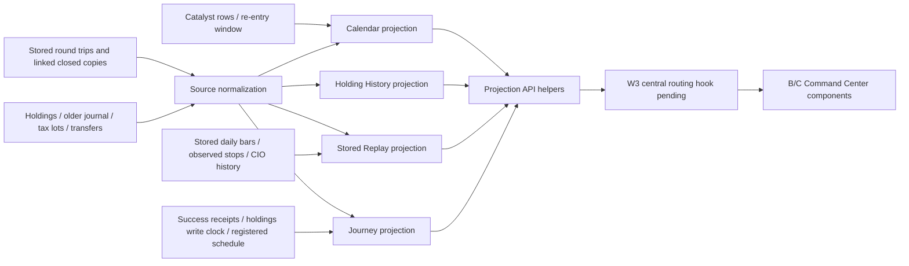

# WP-22 TradeInView A: stored-data lineage and trust

Design-Task: `DSN-20261024-tradeinview-data-P1-T1`.
Source continuation: `codex-tradeinview-a-continue-20261024`, inherited clean
checkpoint `9031d4b775ff88581086f95883016f69e887171d` after the original owner
released claim `a37f0929`. The checkpoint contains accepted post-#2071 base
`8b6cd3be6d9776d3051ea24fbbcfc65248431c45` and the original 25-case work.
This report describes source work, not a deployment or an accepted live run.

The projection combines stored source facts with deterministic server
calculations. It does not generate model intelligence or fetch a market/broker
provider. n8n or host jobs can run the upstream writers; a page request does not
run those jobs, repair a ledger, refresh authentication, or confirm an order.
Unknown basis, missing receipts and unlinked source overlaps remain visible.

## Source and publication boundaries

`api_v3_trade_journey` exports `get_list`, `get_detail`, `get_calendar`,
`get_history`, and `get_replay`. New contracts are registered in the existing
Data Broker catalog and validated by
`config/schemas/tradeinview_projection_v1.schema.json` (Draft 2020-12).

The central `scripts/api_v2.py` source belongs to active W3, so this worker
**does not edit it**. The exact two-site routing patch and its original-file
hash are in [the owner-integration packet](packets/tradeinview-redesign-20261024/api_v2-owner-integration.json).
Calendar/History need exact routes before the generic broker 404. Stored Replay
needs an early delegation before importing `ohlc_charts`; the legacy handler
currently ignores `stored_only` and can reach providers. A/B/C must be combined
with that owner-applied hook before rollout. A successful helper fixture is not
proof that the central HTTP route is installed. No live HTTP request was made.

**Batch-28 integration (coordinator, 2026-10-25):** the owner-integration patch was
applied unmodified to `scripts/api_v2.py` (base sha256 matched the packet) on
`release/batch-28-tradeinview-20261025`; the packet JSON status records it, and
`test_central_api_routes_reach_stored_projections_and_never_the_legacy_provider`
exercises both routes and the stored-only Replay delegation through `api_v2.handle`.

## Original facts, accounting and validation

- `schwab_round_trips` is the authoritative producer for its matched lots.
  `trade_closed.dedupe_key = srt:<id>` is an explicit copy relationship. The
  copy contributes provenance, never a second profit. Disagreements are reported.
  Similar date/price values are not deduplication evidence. A canary parent also
  excludes its linked copy.
- Journeys, Calendar and Replay use that same normalization. Journal history
  occurrences remain separate source observations because the older export
  has no broker trade ID. Same-day overlaps with the newer ledger remain visible,
  but complete counts/profits and even a summed "known" subtotal are withheld
  when distinctness is unproven.
- New Calendar/History/Replay fields convert to ET only for actual offset fill
  instants. Date-only facts remain dates. The pre-existing Journey open-entry
  approximation remains explicitly labelled approximate; it is not a run or
  holdings-sync clock. Daily `bar_time` is a recorded session key, so midnight UTC
  does not move a candle to the previous ET session. Chart epoch coordinates
  are display coordinates, not invented observation timestamps.
- Unknown opening basis does not become zero profit, sale proceeds, win rate or
  a fabricated return. Server sums, counts, medians and percentages retain null
  when their required evidence is unavailable. COMPLETE means named source reads
  were complete, not a claim that the source covers every historical trade.
- Transaction logs, transfers, tax lots and snapshots establish observed account
  membership. They do not justify a second FIFO matcher or a guessed lifetime
  "times held". Distinct holding stretches remain unmeasured without a proven
  opening balance/quantity-transition history. Holding segments are labelled lot
  or snapshot observations.
- Account aliases and names come from the existing account-label registry.
  Numeric account identifiers are not returned as labels. The UI uses names;
  canonical IDs remain linkage/filter fields.
- Company names are read from the existing GUID-bound CIO company-facts
  projection. No new Watch store, per-page model call or company-name guess is
  introduced.

## Field lineage

Notation: `J` = `/api/v3/data-broker/trade-journeys` (or its detail);
`C` = `/api/v3/data-broker/trade-calendar`; `H` =
`/api/v3/data-broker/holding-history`; `R` =
`/api/v2/trade-chart?stored_only=1&trade_id=...`. Central routing remains the
owner-integration dependency above. `[*]` denotes every array member. Metadata
and navigation labels originate in the projection contract, not a market feed.

| UI element | API / JSON field | Store / column or key | Writer or calculation |
| --- | --- | --- | --- |
| Journey identity / Replay link | J `journeys[*].trade_id` | SRT `dedupe_key`/`id`; TC `dedupe_key`/`id`; held account+symbol | `schwab_journal_builder.py`; TC writer; holdings canonical producer |
| Symbol | J/C/H/R `symbol` | originating trip or holding `symbol` | Original writer; uppercase normalization |
| Account name | all `account_label`, option `label` | `config/account_display_names.json` names/aliases | Existing account-display registry |
| Account filter/link identity | all `account_id`, C `account`, option `id` | originating `account`; registry aliases | Existing `canonical_key` |
| Journey state | J `status` | closed-trip presence vs stored positive holdings | Journey projection; never order state |
| Awaiting fill label | J `exit_cause.label`, `tone` | retained `stop_likely_filled` kind | Display rename to Awaiting fill / info; unconfirmed |
| Awaiting reason | J `exit_cause.detail` | recorded mark vs observed stop; registered next sync | Existing exit classifier plus schedule projection |
| Awaiting timeline row | J `timeline[kind=exit_fill, unconfirmed].label`, `tone` | same retained kind + `exit_cause.detail` | "Awaiting fill — mark under stop $X · fill sync <time>", info tone (batch 28 wording; never "likely filled") |
| Awaiting Status row | J `review.facts[key=cause].value`, `tone` | same text as the timeline row | Same approved wording, info tone; still unconfirmed |
| Compare with a win partner | Replay `journeys[*]` with `status=closed` and `pl.amount > 0` | SRT `net_pnl` (realized) | UI filter only; open unrealized gains never count; none → "No closed winning trip yet" (no fallback) |
| Journey total | J `counts.all` | resulting loaded journeys | Server count; loaded window, not inventory total |
| Awaiting filter count | J `counts.awaiting_fill` | retained exit kind | Server count |
| Open/closed counts | J `counts.open`, `counts.closed` | normalized loaded trip status | Existing server counts |
| Internal / own / unknown origin counts | J `counts.internal`, `operator`, `unknown` | recommendation links / CIO history / unknown | Existing origin projection; absence is not Your pick |
| Conflict count | J `counts.conflicts` | underlying conflict records | Server count; shown, not resolved |
| Entry price/time | J `entry.price_ref`, `entry.at` | SRT `entry_price`, `entry_time`; TC buy/open fields | Closed-trip writer; unknown instant stays null |
| Exit price/time | J `exit.price_ref`, `exit.at` | SRT exit fields; TC sell/close fields | Closed-trip writer |
| Recorded mark/time | J `mark.price_ref`, `mark.at` | existing quote/holdings mark projection | Existing Journey source hierarchy, original clock |
| Journey profit/return | J `pl.amount`, `pl.pct`, `note` | SRT `net_pnl`, `pnl_pct`; normalized TC P/L | Server; basis-unknown guard prevents proceeds-as-profit |
| Holding days | J `hold_days` | real entry/exit instants | Elapsed server days; unknown dates stay null |
| Re-entry met/total | J `re_entry.condition_counts.met`, `.total` | deterministic re-entry `conditions[*].met` | Server counts; UI formats |
| Re-entry levels/action | J `re_entry` | `data/runtime/reentry_decision_desk_latest.json` row | Existing `reentry_decision_desk` producer |
| Origin / conviction / stance | J `origin`, `conviction_now`, `stance_now`, `rank_now`, `stage` | CIO prospect; recorded opportunity history/entry/link sources | Existing Journey/CIO projection, with interim label |
| Last closing fill chip | J `freshness_chips[key=last_closing_fill].at` | max loaded true `exit_time` | Closed-trip writer; explicitly not sync time |
| Ledger synced chip | J `freshness_chips[key=ledger_sync].at`, `source`, `source_label` | 1st: runtime ingest receipt `finished_at`/`completed_at` + success status (`run receipt`); 2nd (no receipt — none is written today): `trade_transactions` `max(created_at)` where `import_source='schwab_api'` (`ledger row write`) | `schwab_transaction_ingest.py --apply` replaces its window with fresh rows (read-only here; ingest unmodified). Store clock, not a run receipt. "Not measured" only when the store is unreadable/has no schwab_api rows; warning past the registered `stale_after_hours` of the transactions domain during RTH |
| Holdings synced chip | J `freshness_chips[key=holdings_sync].at` | actual holdings file `st_mtime` bound before/after its read | Holdings canonical writer; never date interpreted as 16:00 |
| Stop monitor chip | J `freshness_chips[key=stop_monitor].at` | `stop_health_last.json` successful `finished_at` | `stop_health_check`/supervisor receipt; no producer execution |
| Stop warning tone | same `.tone` | successful receipt age plus existing market-session service | Warning after 30 minutes during RTH only |
| Next registered broker sync | J `next_broker_sync.at`, lane/expression/timezone/basis | active matching ingest lane in `config/lane_registry.json` | DST-safe `cron_schedule.fires_between`; registered intent, not observed installation |
| Per-row next sync | J `journeys[*].next_sync_at` | same selected registered fire | Same projection, no fixed 15-minute ETA |
| Holdings fact strip | J `reconciliation_facts[key=holdings]` | held shares + bound write clock, or recorded matched quantity | Existing source, labelled explicitly |
| Stop/mark fact strip | J `reconciliation_facts[key=stop_mark]` | observed stop, mark, separate `stop_at`/`mark_at` | Read-only comparison; no fill confirmation |
| Fills fact strip | J `reconciliation_facts[key=fills]` | actual recorded exit and source, or loaded-window gap | Original ledger; no lifetime absence claim |
| Calendar month | C `month` | explicit request `month=YYYY-MM` | Validated request; no DEFAULT_DAYS |
| Calendar names scope | C `names` | request + held symbols / operator-membership projection | Held or held+My Watchlist; source availability explicit |
| Calendar selected account | C `account` | request + account aliases | Filters realized trips; event Names scope remains shared |
| Month realized P/L | C `summary.realized_pl` | normalized month trips `realized_pl` | Sum of known net P/L only when coverage/basis permit |
| Month known P/L | C `summary.known_realized_pl` | same known amounts | Explicit known subtotal, not full profit when incomplete |
| Month trades | C `summary.trade_count` | normalized month trips | Server count, null for incomplete source reads |
| Known month trades | C `summary.known_trade_count` | observed normalized month rows | Server observed count |
| Green days | C `summary.green_days` | fully priced daily totals > 0 | Server; null when basis/read coverage insufficient |
| Active days | C `summary.active_days`, `known_active_days` | dates with observed closed trips | Server; not count of exchange trading days |
| Unpriced count | C `summary.unpriced_trade_count` | rows with null realized profit | Server |
| Calendar date | C `days[*].date` | validated month | Calendar computation; daily fill assignment uses actual ET exit day |
| Day realized / known P/L | C `days[*].realized_pl`, `known_realized_pl` | selected date's normalized trips | Same sum/qualification as month |
| Day trades / observed rows | C `days[*].trade_count`, `known_trade_count` | selected date's normalized rows | Same count/qualification as month |
| Day unknown-profit count | C `days[*].unpriced_trade_count` | selected date's null P/L rows | Server |
| Day symbol contributions | C `days[*].symbols[*].symbol`, `realized_pl`, `known_realized_pl`, `trade_count` | grouped normalized date+symbol rows | Server; never a UI sum |
| Heat magnitude | C `days[*].heat_intensity` | absolute daily P/L / largest known absolute day | Server; null remains uncolored |
| Week boundary / weekdays | C `weeks[*].start_date`, `end_date`, `days`, `included_dates` | requested month and calendar week | Server; Mon–Fri grid; weekend activity separately disclosed |
| Week P/L / known P/L | C `weeks[*].realized_pl`, `known_realized_pl` | all selected rows in that week | Server; totals include disclosed weekend activity |
| Week trades / observed count | C `weeks[*].trade_count`, `known_trade_count` | normalized week rows | Server |
| Day drawer trade facts | C `days[*].trades[*]` | same canonical trip object as Replay | Bounded page; original trip ID and provenance |
| Event identity / kind | C `events[*].id`, `type`, `source_event_type` | catalyst `event_guid`/`id`, type columns | Catalyst producer; unsupported kinds remain Other |
| Event title / symbol | C `events[*].title`, `symbol` | catalyst `headline`/`title`, `symbol` | Original producer |
| Event day / date basis | C `events[*].date`, `date_basis` | actual event/scheduled date; publication date only for catalyst/Other | No publication-to-earnings/ex-dividend date guess |
| Event publication source | C `events[*].source`, `source_ref` | catalyst `source`, `source_url` | Original source; missing source gets reason |
| Event observation time | C `events[*].as_of` | originating `updated_at`/`created_at` | Original source clock, not page/cache time |
| Wash window end | C wash-sale event `date` | re-entry row `wash_until` | Existing desk producer; never loss date + guessed duration |
| Wash event observation | C wash-sale event `as_of` | desk `computed_at` | Original producer |
| Observed event counts | C `days[*].event_counts` | grouped available events by kind | Server; completeness separate from observed count |
| Event page offset/limit/returned | C `events_paging` and day equivalent | validated request bounds + available records | Server pagination, not market facts |
| Event known / complete total | same `known_total`, `total_count` | collected event rows + coverage | Complete total null for truncated/missing/undated sources |
| Next event page | same `next_offset` | page position within observed rows | Server; never implies missing source was collected |
| Trade page metadata | C `days[*].trades_paging` | selected canonical rows | Same bounded paging, independent financial totals |
| Calendar gap preview | C `gaps`, `gaps_paging` | unavailable/truncated/malformed source findings | At most 100 returned; known count discloses omitted findings |
| History eligibility | H `symbols[*]` | >=2 closed source rows or >=2 canonical accounts ever | Server; unlinked distinctness remains qualified |
| Company name / reason | H `company_name`, `company_missing_reason` | GUID-bound C1 company fact | Existing CIO company-facts reader; no inferred company |
| Accounts ever / count | H `accounts`, `account_count` | trips, transactions, embedded journal, tax lots, transfers | Observed membership, not another financial ledger |
| Held quantities / clock | H `accounts[*].held_quantity`, `as_of` | holdings `shares`/`quantity`, original provider clock | Missing account observation is not automatically zero |
| Held-now flag | H `held_now` | observed account quantities | Nullable server flag; tied to the shown snapshot |
| History round-trip count | H `round_trip_count`, `known_trip_count`, `observed_trip_rows` | normalized / legacy rows and overlap checks | Complete vs known vs source-row counts remain separate |
| History realized / known subtotal | H `realized_pl`, `known_realized_pl` | known trip amounts | Overlap or unknown-basis qualification; no invented total |
| Basis flag / trip reason | H `basis_unknown`; trip `basis_reason` | SRT basis status; missing opening price/cost in export | Original facts and explicit missing-basis rule |
| Times held | H `detail.stats.times_held`, `known_holding_stretches` | missing proven opening balance / transitions | Null, with stated reason; not lot count |
| Win rate | H `detail.stats.win_rate_pct` | known winning trip P/L / complete priced trips | Server percentage; null if incomplete |
| Average holding days | H `detail.stats.avg_hold_days` | trip timestamp/calendar-duration facts | Server mean, null if duration/read coverage incomplete |
| Median holding days | H `detail.stats.median_hold_days` | same qualified durations | Server median |
| Best / worst trip % | H `detail.stats.best_trip_pct`, `worst_trip_pct` | recorded trip return percentages | Server min/max, never sale proceeds / zero basis |
| Timeline segment start/end | H `account_segments[*].segments` | closed-trip dates or actual holding observation | Labelled lot/snapshot observations; not invented owning spans |
| Trip buy / sell / shares / P/L | H `detail.trips[*]` | named originating ledger/export columns | Source + record ID + occurrence/provenance retained |
| History range | H `range` | explicit start/end or all available source date bounds | No default 30-day cutoff; no lifetime coverage assertion |
| Fidelity mapping gap | H `gaps[source=release account mapping]` | captured release mapping-file presence only | Presence check does not read/commit credential contents |
| Fidelity sync gap / observed date | H `gaps[source=Fidelity sync]` | latest original stored position observation; sync receipt unavailable | Never equate a position timestamp or file write with success |
| Tax-lot conflicts | H `gaps[source=tax lots vs holdings]` | open lot remaining shares/cost vs holdings shares/cost | Read-only discrepancy; never reconciled automatically |
| Replay trade identity | R `trade_id`, `trade` | exact normalized or older-journal ID; recorded open holding key | No symbol-only guess for a different trade |
| Replay available intervals | R `available_intervals`, `interval` | actual stored daily bar presence | Only 1D proven; 5m/15m refuse instead of provider fallback |
| Candle / close values | R `bars[*]`, `kind` | `market_ohlcv_bars` daily OHLC; `ticker_prices` closes fallback | `market_data_snapshot_loader` / stored price writers |
| Bar session / observation | R bar `time`, `t`, `observed_at` | original stored daily date/time | Session/chart coordinate separated from original instant |
| Fill markers | R buy/sell `markers` | trip original fill timestamp/date and prices | Date-only markers stay date-only; no fabricated intraday fill |
| Stop annotations | R stop `markers` | `stop_last_known` price/account/symbol/captured_at/order_id | Account+symbol+actual holding instant filter; observations, not orders |
| CIO annotations | R CIO `markers` | opportunity assessment symbol/written_at/stance/conviction | Existing recorded opportunity history, within actual holding range |
| Gain / adverse excursion | R `stats.max_gain_pct`, `max_drawdown_pct` | available held-session highs/lows or recorded closes / entry | Server MFE/MAE relative to entry; explicitly labelled daily proxy |
| Metrics basis / gap | R `metrics_basis`, `metrics_missing_reason` | bar kind/coverage and opening basis | No bars/basis/range => null; daily proxy is not exact intraday path |
| Exit type / basis | R `exit_kind`, `exit_label`, `exit_basis` | exact recorded classification when explicit | Otherwise Unknown; mark crossing a stop is not a confirmed stop fill |
| Coach note | R `stats.coach_note` | no matched coach record collected | Null / omitted; no generated coaching prose |
| Source bar table / clock | R `source.table`, `as_of`, `bar_basis` | originating bar collection | Original record clock, with date precision retained |
| Collection clock | C/H/R `as_of`; J `as_of` | source collection timestamp or projection invocation | Cache retains original collection clock; not field observation time |
| Read-only metadata | all `provider_calls`, `writes`, `read_only` | projection execution contract | Source/fixture evidence, not an accepted live-run receipt |
| Missing / coverage reasons | all `gaps`, `coverage`, `missing_reason` | source availability, bounds and validation findings | Explicit unavailable/partial; never zero by substitution |

## Refresh and caching

| Data group | Backend refresh | Consumer behavior / trust boundary |
| --- | --- | --- |
| Journey list and facts | Existing list cache 60 seconds | B polls 60 seconds; detail loads on selection. Cached clocks retain their original meaning. |
| Calendar source snapshot | One in-memory snapshot, at most 60 seconds; `fresh=1` bypass | B polls 60 seconds. Paging changes material returned, not totals. |
| History source snapshot | One in-memory snapshot, at most 60 seconds | C loads on query/manual refresh/reconnect; an open page is not continuously real-time. |
| Replay | Stored-source request on trade/interval selection | No quote/provider streaming; historical daily data. |
| Source observations | Upstream writer's actual schedule/clock | API polling cannot prove a missing writer ran. |
| Ledger/stop success | Actual valid successful receipt | Fresh file mtime, log mtime or page rebuild is not success proof. |
| Next broker sync | Declared registered expression, existing ET default where undeclared | Prediction from intent; no installed scheduler census performed. |

Only Calendar/History broad snapshots are retained, one per kind; Replay is not
cached per trade. The catalyst SELECT returns only used metadata, not the large
raw payload/description. No new persistent store or writer is introduced.
The source read cap is 25,000 rows per collection. Truncation is exposed, not
silently labelled complete. A Calendar grid previews three events and ten trades
per day; selected-day pages and global event pages are bounded to 100. Financial
statistics are calculated before paging.

## Evidence and remaining acceptance

The immutable original COPY is SHA256
`544bf5124797b52ccf3cb9fce1f74147f135339184b7c5a85115b2c1f9bd61c9`,
captured `2026-10-24T20:45:11.301289+00:00`. Its collection was per-query read-only
transactions with separately bracketed file observations, **not an atomic whole
system snapshot**. No new production read was made by this continuation.

The actual Calendar response originally duplicated 2,194 events and occupied
2,697,101 bytes. Paged projection is about 121 KB while preserving the original
30 observed month trips and server financial totals. Event total remains null
because the captured catalyst source was truncated. History currently exposes
116 eligible names after incorporating observed older-journal account membership;
AXTI retains 13 source trips. AXTI, V, SCHD, SCHG, SPCX and NFLX retain real account
names. History/Calendar Replay links have matching source-derived Replay exports.

The COPY did not capture bars, recommendation/identity/CIO-history collections or
observed-stop rows. Its Replay proof therefore validates a genuine recorded trade
with explicit missing bars and null metrics. Positive bars/closes and fresh/stale
receipt states are separately labelled pinned synthetic producer fixtures, not
invented production observations. Missing ingest success remains NOT_MEASURED.
Adding instrumentation to its broker-adjacent producer needs its separately
scoped engineering authority; this source package does not edit that producer.

The canonical virtualenv initially failed one schema test because `jsonschema`
was absent (46 passed / 1 failed). No install was attempted. Existing system
Python 3.14.4 with jsonschema 4.19.2 performs the full Draft 2020-12 proof under
the psycopg2-hidden barrier. The dependency is pinned in the test-only
`requirements-ci-tradeinview.txt`; four existing CI test jobs install it. Draft
and ready guards, old test commands and production requirements are preserved.
Batch-28 CI note: required runners that do not install that file now validate every
payload with the stdlib Draft 2020-12 subset validator `tests/helpers/tradeinview_schema.py`
(every schema keyword implemented and pinned; jsonschema, where installed, must agree), so
no schema evidence is skipped. Earlier checkpoints and final frozen receipts are recorded separately; scoped
passes are never called whole-project CI.

Pending: W3 central routing integration; final B paging/actual-fixture and C
shell integration; required exact-PR checks; operator publication/release; and
an authorized served readback. The snapshots, receipts and source package do
not assert deployment, n8n admission, scheduler changes, broker repair or live
order/fill confirmation. See [the proof packet](packets/tradeinview-redesign-20261024/README.md).

## My questions grouping (Screen 5) — field lineage

Notation: `A` = `GET /api/v2/cio/asks?group_by=…&q=&channel=` (`data.grouped`, built by
`scripts/lib/cio_ask_groups.py`); `T` = `GET /api/v2/cio/asks/<thread_id>`; store = the ask ledger
`cio_ask_events.jsonl` (`scripts/lib/cio_ask_store.py`, writer `cio_ask_core.finish_turn` / `record_answer`).

| UI element | API / JSON field | Store / column or key | Writer or calculation |
| --- | --- | --- | --- |
| Group by buttons (and which exist) | A `grouped.group_bys[*].id`, `.available`, `.reason` | constant set; Theme availability = thesis catalog has ≥1 thesis with tickers | `cio_ask_groups.load_themes` (`config/thesis.json`); unavailable → button omitted + reason shown |
| Search / channel | A `grouped.q`, `grouped.channel` | request echo | Server filter over question text + entity symbol/name; channel = `ask.asked.channel` |
| Security group key / label | A `groups[*].key` (`security:<guid>`), `label`, `symbol`, `security_guid` | `ask.entity_resolved.entity.security_guid`, `.symbol` | Resolution at ask time (registry GUID); private entity → `entity:<entity_guid>`; none → "No security resolved" |
| Security sub-line | A `groups[*].sub` | C1 `company_facts.company/sector/industry.value` for the GUID | `cio_company_facts` on the CIO InstrumentRecord; missing → omitted, never inferred |
| Sector group | A `groups[*].label` (group_by=sector) | C1 `company_facts.sector.value` | Missing → "Unclassified" |
| Theme group | A `groups[*].label` (group_by=theme) | `config/thesis.json` `<thesis>.description` / `.tickers` | Name in no thesis → "No theme" |
| Date group | A `groups[*].key` (group_by=date) | `ask.asked.asked_at` | ET calendar day (zone-aware instant only; naive → "Date not recorded") |
| Counts | A `groups[*].counts.questions`, `.threads`, `.names` | questions in group; distinct `thread_id`; distinct entity symbols | Server counts; re-answer turns are not questions |
| CIO memory — last answer | A `groups[*].memory.last_answer_at` | newest `ask.answer_version.answer.produced_at` in the group | Server max; none → "no answer recorded yet" |
| CIO memory — stance / conviction | A `groups[*].memory.stance`, `.conviction`, `.stance_as_of`, `.stance_source` | CIO prospect record (`cio_prospect` projection) when its store is live | Not live → `stance_missing_reason` ("CIO prospect store not live (…)"); security groups only |
| Question row | A `groups[*].questions[*].question`, `channel`, `depth`, `asked_at` | `ask.asked` + newest `ask.answer_version` | Ledger fold (`AskEventStore.threads`) |
| Manual regroup | POST `/api/v2/cio/asks/<thread_id>/regroup` → `ask.group_override` {ask_id, group_by, group_key|null} | ask ledger event (append-only) | Newest override per (ask_id, group_by) wins; `null` = Ungrouped; history never edited |
| Related from CIO memory | T `related_from_memory[<ask_id>][*]` (`ask_id`, `question`, `asked_at`, `thread_id`, `missing_reason`) | `ask.answer_version.answer.recall[*].items[*].ref` persisted at answer time | Only refs the answer actually recalled; unresolvable ref → `missing_reason`; no fresh similarity search |
| Tracking chips / follow-up | T `thread.entities[*].tracking`, POST `/api/v2/cio/ask` | existing ledger events | Unchanged (Phase 8) |

Proof: `tests/test_cio_ask_groups_20261025.py` (synthetic ledger), builder-generated browser fixture
`apps/command-center-v3/e2e/fixtures/myQuestionsGroups.fixture.json`, phone taps at 412/390 and screenshots of every
grouping + empty state in `e2e/my-questions-groups.spec.ts` (wired into `ask-cio-readable-fixture`). No real-tree
receipt for `group_by` was taken: the host ask ledger is production state and this branch reads only fixtures.
