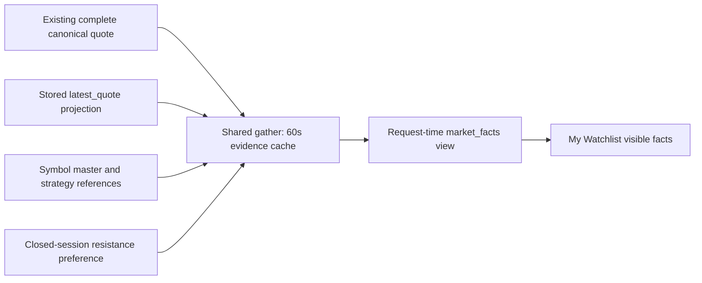

# WP-29: My Watchlist stored market facts

Status: DRAFT — local source and fixture verification complete; publication/merge pending
as_of: 2026-10-24T05:46:00Z
Base: `058976798e8883777244820e43fa192e2dd676c3` (accepted batch 16, including account-name/H1 source `50131756f`)
Design-Task: DSN-20261024-watch-my-list-market-facts-P1-T1

My Watchlist now shows **Price, Support and Resistance** with visible source, observation time, stale/unknown state and a specific missing/fallback reason. A missing price does not erase known structural levels: those remain visible with an unknown nearest-level relation. Values below one dollar retain sufficient precision to display distinct sub-cent prices and levels. No level is calculated from a target, stop or moving average.

The strip belongs only to My Watchlist. Existing account-name chips, heading, Watch decisions, actions, filters and the Prospects grid remain intact. Existing recorded `next_trigger` and `distance_pct` belong to the decision snapshot and are not recomputed from the added price. The synthetic screenshots retain an inherited trigger zone beside the separate quote facts; that zone/distance is not a current-quote calculation.

## Lineage and field contract

Only operator-list symbols are included in the stored read batch, rather than the full curator universe. Four independent batch reads cover the existing quote projection, symbol master, latest strategy cards and the single resistance preference. There are no provider calls, new stores, writers, broker operations or workflow changes. Missing tables/read failures degrade that source without erasing the other facts; raw database exception or credential details are not returned to the UI.

| Field | Source and selection | Observation/freshness meaning |
|---|---|---|
| Price | Complete existing canonical Watch artifact, including winning-record identity and upstream provider where present. Generic partial legacy provenance uses the existing stored `data_broker.latest_quote` projection. Explicit canonical identity failure remains closed. | Original record price/source/time and artifact stay together. Canonical freshness uses the existing CC contract; stored latest_quote uses its existing 900-second bound. Missing/future/unknown timestamp is explicitly unknown/stale. |
| Support | First finite positive compatible `watchlist_symbol_master.support`; then latest `watchlist_strategy_cards.support`. | Master exposes no level observation time; strategy `created_at` is identified as card creation time. Level freshness stays unknown. |
| Resistance | Same master→strategy precedence, then an explicit usable `portfolio.reentry.resistance.v1` resistance reference. Crossed/invalid primary references have a fallback explanation. | Closed-session cache retains its own date/state/source. Cache rebuild `generated_at` never becomes an observation timestamp. No support is invented from that resistance fallback. |

`market_facts` is an additive `WatchMarketFacts@v1` row field. Each displayed field carries value/source/source label/as-of/freshness/stale/reason; levels also carry compatibility and timestamp basis. The raw evidence snapshot is cached by `watch_prospects.gather`; `watch_curation` derives the display view using the **request** clock. Tests demonstrate the same cached quote aging from 880 to 910 seconds while its source/time, GUID and original decision row remain unchanged. A separately old `gather.now` cannot make a current request use the old clock.

Transport freshness is separate from observation freshness. My Watchlist consumes the existing hook's stale/error state: after a failed poll, a sanitized refresh-unavailable banner appears and retained values show **Last snapshot**, withdrawing **Current**. Values, source and observation time remain unchanged. The shared API hook and global freshness policy are not changed; a terminal 403 still receives no automatic repeat.

The existing SharedIntelligenceBridge resistance-missing banner describes a different shared-preference population of closed exits. This row reference strip does not rewrite that population, banner, or its business gates. A row reference and that banner can legitimately have different coverage/date semantics.

## Browser evidence

| State | 1440 × 1000 | 412 × 1300 |
|---|---|---|
| Current stored quote | [PNG](packets/watch-market-facts-20261024/current-1440.png), [input/display receipt](packets/watch-market-facts-20261024/current-1440.json) | [PNG](packets/watch-market-facts-20261024/current-412.png), [receipt](packets/watch-market-facts-20261024/current-412.json) |
| Stale quote, original time retained | [PNG](packets/watch-market-facts-20261024/stale-1440.png), [receipt](packets/watch-market-facts-20261024/stale-1440.json) | [PNG](packets/watch-market-facts-20261024/stale-412.png), [receipt](packets/watch-market-facts-20261024/stale-412.json) |

The four unedited PNGs were visually inspected; the independent root worker/reviewer also reviewed desktop/phone source/time readability, preserved names/H1 and no horizontal clipping. They use synthetic `SPCX` facts and a pinned clock, not live holdings or market observations. Empty/stale header panels and the local `source UNAVAILABLE` build footer are fixture/build context, not served-release health evidence.

Final Chromium run: **40 passed**, zero failed/skipped/flaky — 18 new cases plus 22 existing Watch regressions. Cases include current/stale/unknown/future timestamps, missing price with known levels, missing support reasons, sub-cent values, MyList-only scope and initial success→503/403 poll failure with the clock advanced. Failed-refresh cases preserve the quote's source/time and withdraw Current; 403 also proves polling stops. New cases fulfill every API GET, reject attempted mutations/external HTTP and assert zero page errors. Existing action regressions use only mocked POST responses.

The preview uses `configFile:false`, an empty environment directory and `proxy:{}`; it has no live API proxy. No live server/provider/credential was accessed. Its own process was stopped after verification. The optional `watch-market-facts-ui-validation` workflow runs the actual new browser spec at the published head, with read-only permission, exact draft guard, ready-for-review trigger, main-only push and PR concurrency cancellation.

## Verification and explicit non-green result

- **88 backend/Watch tests passed**, including 32 new pinned-clock tests, with psycopg2 hidden. [Green receipt](packets/watch-market-facts-20261024/backend-watch-green.xml).
- Static data-source-authority checker: **zero findings**; its 32 regression cases passed. The 95 draft-workflow checks passed. New test registration uses canonical `scripts.lib.ci_gates.render`.
- `npm run build`, Ruff, host-path/coverage ratchets, documentation INDEX, whitespace, source/claim and secrets checks pass. No new host-path violations or unlisted tests.
- The supplementary canonical-quote/authority/workflow profile is explicitly **NON_GREEN: 144 passed, 2 failed of 146**. [Full unchanged receipt and tracebacks](packets/watch-market-facts-20261024/supplementary-guards-NON_GREEN.xml.gz) are preserved byte-for-byte in deterministic gzip form (`gzip -cd docs/ops/packets/watch-market-facts-20261024/supplementary-guards-NON_GREEN.xml.gz`; the manifest includes the uncompressed hash). `TestLiveCoherenceIdentity::test_live_symbols_have_coherent_identity` attempts a real DB path; the hidden driver prevented a connection, then the existing code calls `None.cursor`. `TestUiProvenanceContract::test_watchcard_exposes_provenance_attrs` expects obsolete quote props in WatchHub. The independent root worker/reviewer verified these test/helper/WatchHub sources unchanged from base and recorded a separate follow-up. The live test was not retried, the driver was not exposed and no baseline/assertion was weakened.

[verification.json](packets/watch-market-facts-20261024/verification.json) binds source hashes, image/receipt dimensions/digests and the distinct test populations. Full local build/browser/authority receipts are under `~/.cache/rtc/codex-watch-market-facts-20261024/`. The source is independently reviewed for provenance, fallback, partial failures and clock behavior.

The worker commits one tested package and records one `PUSH_NEEDED`, retaining the source claim. The coordinator/operator publishes it, reviews required exact-head CI and merges/releases. Live endpoint readback, actual database coverage and deployment are unmeasured by this worker; fixture proof does not assert production readiness.
